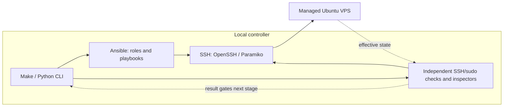

# Portfolio Server Infrastructure

**English** | [Русский](README.ru.md)

[](https://www.python.org/)
[](https://docs.ansible.com/ansible-core/2.18/)
[](https://docs.docker.com/engine/)
[](https://ubuntu.com/server)
[](https://github.com/DanilFaritovich/portfolio-server-infrastructure/actions/workflows/ci.yml)
[](LICENSE)

Portfolio Server Infrastructure prepares an Ubuntu VPS for a personal portfolio or other self-hosted applications. An interactive CLI runs Ansible stages, verifies access between changes and leaves you with a Docker-ready server, a host firewall, separate administrator access and a bounded system maintenance policy.

It is intended for operators who can review SSH and sudo permissions and recover a server through its provider console. Application deployment is a separate task: this repository does not deploy a website, reverse proxy, domains, TLS certificates or application networks.

## Features

- **Guided initialization:** `make init-server` coordinates bootstrap, Docker, hardening, human access, final SSH security and server operations, with independent verification between stages.
- **Ansible provisioning:** reviewable roles and idempotent configuration; converged provisioning avoids unnecessary changes and service restarts.
- **Docker host:** official Docker Engine packages, Compose and Buildx, bounded `local` container logs and a disposable runtime smoke test.
- **SSH and UFW:** validated listening ports, IPv4/IPv6 firewall rules and final key-only SSH with root, password and keyboard-interactive login disabled. Stock SSH service and socket activation modes are preserved.
- **User management:** separate human keys, explicit sudo policies, account/key inspection, additive key registration, exact key revocation and guarded account removal.
- **System maintenance:** Ubuntu security-origin unattended updates, bounded journald retention and stock maintenance timers, without automatic reboot or package removal.
- **Failure handling:** strict host trust, default-deny confirmations, unchanged-state checks, locks and pending activation evidence. Failures stop later stages; retained administrator/console access supports deliberate recovery.

## Technology stack

| Technology | Role in this project |
| --- | --- |
| Python 3.12 | Project-managed controller runtime for the CLI, validation and local VM lifecycle; the server uses its own `/usr/bin/python3` |
| Ansible Core 2.18.6 · `ansible.posix` 2.0.0 | Separate provisioning roles and verification playbooks for each server stage |
| OpenSSH · Paramiko 5.0.0 | Key-only managed access and independent proofs; pinned password-only bootstrap and signed host-trust probes |
| Docker Engine · Compose · Buildx | Official server packages, bounded container logging and runtime smoke verification; versions come from the Docker APT repository |
| Ubuntu · systemd · UFW | Target OS, SSH service/socket activation, host firewall, journald and security-update timers |
| uv 0.12.23 · Make | Checksum-verified local toolchain installation and a common command interface |
| ansible-lint 25.5.0 · yamllint 1.38.0 · actionlint 1.7.7 · unittest | Offline configuration, workflow and controller regression checks |
| KVM/QEMU · libvirt · cloud-init | Optional isolated local Ubuntu VM for operator-run integration scenarios |

Controller/tool pins are defined in [requirements-dev.txt](requirements-dev.txt), [collections.yml](collections.yml) and [setup scripts](scripts/setup.sh). Server release limits and recorded platform results are listed under [compatibility](#compatibility); CI runs on Ubuntu 24.04.

## Architecture

The controller is your local computer; the managed host is the Ubuntu server. The CLI owns local keys, trust, confirmations and sequencing. Ansible roles apply server configuration; independent SSH and server inspectors verify it.



**Initialization order:** local setup → automation access → Docker → SSH ports/UFW → human administrator → final SSH policy → confirmed system operations → STOP. Each stage must pass independent verification before the next; applications are deployed separately.

| Boundary | Responsibility |
| --- | --- |
| Local controller: `scripts/access.py` → `portfolio_cli` | Validate inputs, select identities, maintain host trust, confirm plans and serialize stage dispatch |
| Managed VPS: `playbooks/` and `roles/` | Apply the selected stage through Ansible; server-side `library/` and `scripts/user_management.py` remain separate payloads |
| Independent verification: SSH and streamed inspectors | Prove access and effective server state; read-only inspectors run over stdin without remote payload files |
| Optional local VM: `scripts/e2e.py` → existing CLI | Own the isolated guest/NAT/snapshots and guard scenario dispatch; reuse provisioning and verification stages |

See [ARCHITECTURE.md](ARCHITECTURE.md) for module responsibilities and security boundaries, and the [operator guide](docs/operator-guide.md) for individual stage procedures.

## Key engineering decisions

| Decision | Rationale and consequence |
| --- | --- |
| Separate changes from independent proofs | A successful Ansible recap alone cannot prove future login. Fresh key-only SSH/sudo and stage verifiers gate subsequent operations |
| Keep authentication transitions explicit | Password bootstrap, managed automation and human administration use distinct access paths. Final SSH restrictions require proven independent administrator access and recovery confirmation |
| Validate before activation | Full SSH candidates and effective listeners are checked before activation. Docker, Stage 3 SSH and journald pending markers preserve evidence when activation is incomplete |
| Refuse unsafe drift rather than repair it | Preflights reject unmanaged or ambiguous state; ownership ledgers, snapshots and locks bound approved changes. Operators diagnose failures before explicitly continuing |
| Install tooling locally | Pinned dependencies and checksum-verified installers avoid system Python/uv requirements and keep Make/Ansible subprocesses on the same toolchain |
| Reuse the production workflow in isolated E2E | VM scenarios call existing initialization/reboot wrappers with native confirmations. Offline tests mock external commands; real VM and production acceptance remain separate operator checks |

## Documentation and operating routes

Start with [Quick Start](#quick-start) for a fresh VPS, then use the [command reference](#command-reference) for individual operations. Review [security and recovery](#security-limitations-and-recovery) before LIVE changes.

- [Operator guide](docs/operator-guide.md): detailed stage contracts, inventory migration, key/trust transfer and recovery.
- [Architecture](ARCHITECTURE.md): module responsibilities, dependencies and security boundaries.
- [Local VM E2E guide](docs/local-vm-e2e.md): host preparation, console checks, snapshots and fixture lifecycle.
- [Validation record](docs/validation.md): recorded offline and operator-reported results with evidence limits.

## System requirements

| Component | Requirements |
| --- | --- |
| Controller | Linux x86_64 or arm64 with glibc; Git, Make, POSIX shell, curl, tar/gzip, coreutils including `sha256sum`, and OpenSSH clients (`ssh`, `ssh-keygen`, `ssh-keyscan`, `scp`, `sftp`) |
| Local tooling | Setup downloads pinned uv, managed Python 3.12, Ansible, Paramiko, collections and validation tools into the project. Preinstalled Python/uv, Go and sshpass are unnecessary |
| Managed host | Ubuntu Server with systemd, `/usr/bin/python3`, `python3-apt`, `/bin/bash`, sudo, `/usr/sbin/visudo` and an active `/etc/sudoers.d` include. Docker's release allowlist is Jammy 22.04, Noble 24.04 and Resolute 26.04; this is not an E2E acceptance claim for each release |
| Initial access | A fresh host with SSH password access as root, or an existing password-capable administrator with sudo. A verified provider host-key fingerprint, tested recovery console and a retained administrative session |
| Network | Controller access to dependency registries; server access to Ubuntu/Docker repositories and Docker Hub. Provider firewall rules must allow the intended SSH ports |
| Optional local E2E | Linux x86_64, hardware virtualization, KVM and system libvirt, at least 2 available CPU cores, 4 GiB guest RAM and space for a 25 GiB disk, image and snapshots |

Run Make as your normal controller user. `make setup` uses no sudo and installs no system packages. E2E preparation may offer separately confirmed host package/group/storage changes; read its [host requirements](docs/local-vm-e2e.md#host-preparation-explicit-operator-consent) first.

## Quick Start

This route is for a **fresh server**. Commands after local setup contact and may change the server (**LIVE**). Before approving a plan, review its target and permissions, allow SSH in the provider firewall and test provider-console recovery. For an already secured server, use the [migration procedure](docs/operator-guide.md#managed-user-configuration-and-migration) instead of password bootstrap.

### 1. Clone and prepare the controller

```bash
git clone https://github.com/DanilFaritovich/portfolio-server-infrastructure.git
cd portfolio-server-infrastructure
make setup
```

Accept the local dependency plan after review. Setup creates `inventories/production.yml` from the [example](inventories/production.example.yml) only when missing; it never overwrites an existing inventory. Tooling remains in `.tools/`, `.venv`, `.ansible/` and `.cache/`. Setup needs registry access, but never contacts a VPS.

### 2. Configure inventory

Edit the local `inventories/production.yml`, keeping its one-host structure. Replace `vps.example.invalid` with your server's exact hostname or IP and set its existing SSH port:

```yaml
all:
  children:
    bootstrap:
      hosts:
        portfolio:
          ansible_host: vps.example.invalid
          ansible_port: 22
          bootstrap_login_user: root
          ansible_user: ansible
          ansible_private_key_file: ~/.ssh/portfolio-server-infrastructure/ansible_ed25519
          ansible_python_interpreter: /usr/bin/python3
          ssh_listen_ports: [22]
          ssh_verify_ports: [22]
          firewall_allowed_tcp_ports: [80, 443]
```

Set the three access fields together: `bootstrap_login_user` is used only for initial password bootstrap; `ansible_user` and `ansible_private_key_file` select subsequent managed access. Choose an unused non-root automation account. Do not put passwords, key contents or unrelated variables in inventory, and keep real inventories out of Git.

Keep the current SSH port in `ssh_listen_ports` during a transition. `ssh_verify_ports` defaults to all listening ports and must include the current inventory port. Opening 80/443 does not install a web server. See [port migration and provider prerequisites](docs/operator-guide.md#host-hardening-stage-stage-3).

### 3. Prepare an independent human administrator key

Choose an unused account name, for example `portfolio_admin`:

```bash
make generate-user-key HUMAN_USER=portfolio_admin
make show-public-key HUMAN_USER=portfolio_admin
```

The default key path is `~/.ssh/portfolio-infra/portfolio_admin_ed25519`; existing pairs are preserved. For an encrypted key, run `make load-user-key HUMAN_USER=portfolio_admin` in a shell with an existing SSH agent. The CLI never starts an agent; see the [key guide](docs/operator-guide.md#agent-loading-and-a-new-computer-with-one-encrypted-key). Bootstrap creates the separate automation key without a passphrase. Automation and `HUMAN_SUDO=admin` grant root-equivalent `NOPASSWD: ALL`; protect the controller and keys.

### 4. Initialize the server

In an interactive terminal:

```bash
make init-server INIT_FROM=bootstrap HUMAN_USER=portfolio_admin HUMAN_SUDO=admin \
  HUMAN_KEY="$HOME/.ssh/portfolio-infra/portfolio_admin_ed25519" \
  HUMAN_PUBLIC_KEY="$HOME/.ssh/portfolio-infra/portfolio_admin_ed25519.pub"
```

Review the preliminary plan and recovery attestation. Default-deny approval covers only the listed operations in this invocation; native host-trust, password and passphrase prompts remain. On first connection, compare the displayed host fingerprint with the provider console/panel before trusting it. A network scan alone does not establish identity. The bootstrap password is entered through Ansible's native prompt and is not stored by the project.

Initialization verifies each stage before proceeding. Final SSH security requires independently proven human administrator and automation access. It disables root/password/keyboard-interactive SSH only after those proofs; Stage 5 configures scheduled security updates and log limits. No application deployment or reboot is included.

### 5. Verify the completed server

```bash
make init-server INIT_FROM=verify HUMAN_USER=portfolio_admin HUMAN_SUDO=admin \
  HUMAN_KEY="$HOME/.ssh/portfolio-infra/portfolio_admin_ed25519" \
  HUMAN_PUBLIC_KEY="$HOME/.ssh/portfolio-infra/portfolio_admin_ed25519.pub"
```

This verifies the full pipeline without provisioning. Docker verification creates/removes a smoke container and may populate the image cache. `make connect-user HUMAN_USER=portfolio_admin` opens an interactive human session after verification.

After an error, **stop and diagnose before continuing**. `INIT_FROM` also accepts `docker`, `hardening`, `human`, `ssh` or `operations`; earlier stages must pass fresh verification. Choosing a later stage is an explicit decision after diagnosis, not automatic recovery. See [interrupted stages](docs/operator-guide.md#interrupted-stages-and-safe-repetition).

## Command reference

These are actual [Makefile](Makefile) targets. Server commands use `INVENTORY=inventories/production.yml` by default. Local operations, offline checks and LIVE server/VM operations have different effects; verification is not always free of runtime changes.

### Controller and offline checks

| Command | Purpose / effect |
| --- | --- |
| `make setup` | Install local tooling and create missing inventory; registry access |
| `make deps` / `make deps-ci` | Dependencies only: interactive / explicit noninteractive CI mode |
| `make generate-user-key HUMAN_USER=NAME` / `make load-user-key HUMAN_USER=NAME` | Generate a non-overwriting key / load it into an existing agent |
| `make show-public-key HUMAN_USER=NAME` / `make copy-public-key HUMAN_USER=NAME` | Display / copy public key material only |
| `make show-controller` | Validate local key/trust and display inventory access |
| `make check` / `make ci` | Aggregate offline checks with example inventory and synthetic fixtures |

See the operator guide for [keys and interactive SSH](docs/operator-guide.md#local-keys-and-interactive-ssh), [trust export/import](docs/operator-guide.md#transfer-server-trust-to-a-second-computer) and [individual checks](docs/operator-guide.md#commands-and-boundaries). Trust import requires confirmation; an optional LIVE proof on another port is separately confirmed. Clipboard operations may offer local package installation.

### Server initialization and maintenance — LIVE

| Command | Purpose / effect |
| --- | --- |
| `make init-server` | Guided initialization or full verification; select `INIT_FROM` |
| `make bootstrap-user` / `make verify-access` | Create automation access / prove independent key-only SSH and sudo |
| `make docker-host` / `make verify-docker` | Provision Docker with postflight / runtime and disposable container checks |
| `make inspect-hardening` | Read-only Stage 3 safety report; FAIL blocks changes |
| `make harden` / `make verify-hardening` | Configure SSH ports/UFW / verify listeners, routes and firewall |
| `make add-user` / `make verify-user` | Register human access / prove the selected key and sudo policy |
| `make secure-ssh` / `make verify-ssh-security` | Apply final authentication policy / verify policy and independent access |
| `make inspect-operations` | Read-only system maintenance readiness report |
| `make setup-operations` / `make verify-operations` | Configure security updates, logs and timers / verify policy and services |
| `make preview-apt-policy` / `make apply-apt-policy` | LIVE check-diff / confirmed exact missing-line APT migration, with wider drift refused |
| `make reboot-host` | Confirm reboot; then verify access, Docker and Stage 3 hardening |
| `make connect-controller` / `make connect-user HUMAN_USER=NAME` | Interactive key-only SSH as the inventory controller / selected human |

### Users and keys — LIVE

| Command | Purpose / effect |
| --- | --- |
| `make list-users` / `make show-user HUMAN_USER=NAME` / `make list-user-keys HUMAN_USER=NAME` | Inspect recorded users, rights and keys |
| `make add-user-key HUMAN_USER=NAME HUMAN_PUBLIC_KEY=/path/key.pub` | Add one explicit public key, preserving other entries |
| `make revoke-user-key HUMAN_USER=NAME KEY_FINGERPRINT=SHA256:...` | Revoke one managed key; separate recovery proof |
| `make remove-user HUMAN_USER=NAME` | Revoke credentials/sudo and remove the account, retaining files; separate recovery proof |

`add-user` requires an explicit public file or pasted input in a terminal. Destructive operations require `RECOVERY_USER`/`RECOVERY_KEY` for a different independently proven administrator with disjoint keys; root, the current controller and unmanaged state are protected. See the [user guide](docs/operator-guide.md#user-and-ssh-key-management-stage-6-task-3) for sudo/group policies, additive keys without privilege migration and removal restrictions.

### Local VM lifecycle — real local operations

`make e2e-list-distros` reads only the local registry. `make e2e-prepare`, `make e2e-status`, `make e2e-test`, `make e2e-reset` and `make e2e-delete` operate a real fixture outside CI. See the [short scenario below](#e2e-on-a-real-ubuntu-vm) and the [E2E guide](docs/local-vm-e2e.md) for preparation, stop and deletion requirements.

## Testing and recorded results

Once dependencies are installed:

```bash
make check
```

Checks run YAML/Ansible/workflow lint, Ansible syntax validation and offline Python tests with synthetic fixtures and mocked SSH, downloads and hypervisor commands. They use the example inventory, require no production credentials and do not contact a server or launch a VM. [GitHub Actions](.github/workflows/ci.yml) runs `make deps-ci` followed by `make ci` on Ubuntu 24.04.

Real E2E on an Ubuntu Server 24.04 LTS amd64 guest with an Ubuntu 26.04 controller was run manually by the operator: [PR #11](https://github.com/DanilFaritovich/portfolio-server-infrastructure/pull/11) supports preparation/initialization, and the operator's subsequent confirmation covers repeat execution, reboot, user management and deletion. These are existing recorded results, not new runs during documentation editing; see the [validation record](docs/validation.md) for detailed provenance and limits.

| Check | Recorded result |
| --- | --- |
| Offline / CI: lint, Ansible syntax, Python tests | Passed |
| E2E: VM creation and full Stage 1–5 initialization | Passed |
| E2E: final verification, repeat convergence and verification after reboot | Passed; smoke-test runtime changes remain expected |
| E2E: user creation/verification, key addition/revocation, user and fixture deletion | Passed |
| External production VPS, other platforms | Not established by this run |

Offline success does not prove live access, idempotency or provider recovery; a VM result does not establish acceptance on every allowed release or platform.

## E2E on a real Ubuntu VM

This optional interactive route creates a real local KVM/libvirt guest with isolated inventory, HOME, keys and host trust. It is outside offline checks and CI. Read the [full E2E operator guide](docs/local-vm-e2e.md) before approving host changes or creating a VM. The registry includes Ubuntu Server 24.04 LTS (default) and 22.04 LTS.

### Prepare and run the full scenario

```bash
make deps
make e2e-list-distros
make e2e-prepare E2E_DISTRO=ubuntu-24.04
make e2e-status
make e2e-test E2E_FROM=bootstrap
```

Run each command only after the previous one succeeds. Before creating a VM, read [first-run and console checks](docs/local-vm-e2e.md#prepare-and-first-run): package/group/storage changes require consent, and fingerprints/recovery access require verification. Readiness is bounded to 300 seconds and graceful shutdown to 120; errors retain the fixture for diagnosis without automatic reset.

The scenario creates a separate `e2e_admin`, initializes and verifies the server, requires provisioning convergence with `changed=0` and checks state after reboot. See [scenario details](docs/local-vm-e2e.md#isolation-and-scenario-execution) and [reset/deletion/recovery](docs/local-vm-e2e.md#reset-deletion-and-incomplete-preparation).

### Exercise users and keys

In the running guest, follow the [operator guide](docs/operator-guide.md#exercise-users-and-keys) to create a user, verify both keys, revoke the extra key and remove the account. Keep console access and a separate recovery administrator. Wrappers neither start nor reset the VM; fixture deletion requires separate confirmation.

## Compatibility

| Platform | Status / limits |
| --- | --- |
| Linux controller, glibc x86_64/arm64 | Implemented local toolchain path; recorded acceptance is limited to the environment in the results table |
| Ubuntu Server | Docker allows 22.04/24.04/26.04 subject to all stage preflights; release allowlists are not E2E acceptance |
| Windows through WSL2 | **Not tested.** Requires the Linux prerequisites; agent, paths, clipboard and networking need independent checks. No KVM/libvirt E2E acceptance is claimed |
| Native Windows / macOS controller | Full setup is unsupported by the Linux-only toolchain installer. A macOS clipboard backend does not imply full platform support |
| Other server OS / custom host configurations | Outside the implemented Ubuntu pipeline; custom SSH/systemd/UFW/Docker policies may be refused by safety preflight |

E2E host eligibility is based on Linux x86_64/KVM/libvirt capabilities rather than a host release allowlist. Automatic missing-package installation is restricted to reviewed Ubuntu/Debian APT environments; other systems require manual prerequisites. A registry entry or code allowlist does not prove a successful end-to-end run.

### Windows through WSL2 — untested

This is a preliminary route for running the Linux CLI, not an officially tested platform. It requires Windows with WSL2 support, enabled hardware virtualization and an Ubuntu Linux distribution with glibc on x86_64/arm64.

1. Install WSL/Ubuntu with `wsl --install` in administrator PowerShell and restart Windows as described in [Microsoft's instructions](https://learn.microsoft.com/en-us/windows/wsl/install). Check version 2 with `wsl --list --verbose`.
2. Open Ubuntu, create a normal Linux user and install Git, Make, curl, tar/gzip, coreutils and the OpenSSH client. Keep the repository and keys in Linux HOME, for example `~/work/`, to preserve Linux permissions.
3. Run the clone commands and `make setup` from [Quick Start](#quick-start) inside WSL. System Python/uv are unnecessary. Before LIVE commands, check registry access, connectivity to the VPS SSH port, host trust and encrypted-key loading in that Linux shell's agent.

Paths, agent, networking and clipboard behavior need independent checks. Local KVM/libvirt E2E on WSL2 is **not confirmed**; successful WSL installation does not establish VM-fixture suitability.

## Security, limitations and recovery

Keep inventories, private keys, passwords and diagnostic logs out of Git. Only public keys are transferred; private material stays with its owner. SSH transports pin the selected identity, require existing strict host trust and disable forwarding/client-config overrides. Encrypted identities must be loaded in the invoking shell's agent. Trust transfer is separately confirmed and never replaces conflicting host keys.

The automation account and human administrators have root-equivalent sudo. Public-key registration alone cannot prove login; independently verify the matching identity before final SSH policy or destructive changes. Review supplementary group rights explicitly. Keep a tested provider console and retained administrator session throughout security changes.

Idempotency applies to supported, unchanged managed state. Unsafe drift, unmanaged accounts/configuration, conflicting runtime packages, ambiguous UFW/SSH state and pending activation block changes. The project does not automatically uninstall conflicting packages, reset UFW, adopt accounts, clear receipts, downgrade SSH policy, roll back an interrupted pipeline or prune data. SSH loss does not prove that remote work stopped; diagnose before retrying. The local CLI lock serializes one controller user, while other computers and raw Ansible need manual coordination.

UFW host-input policy does not by itself protect Docker-published container ports. Review provider and container networking before separate application deployment. Security updates can restart services later through package scripts; Stage 5 does not reboot automatically. Limits on Docker/journald logs do not cap every application file.

Use these references before operating on a server:

- [Stage contracts, security policies and diagnostics](docs/operator-guide.md).
- [Interrupted activation, pending markers and recovery](docs/operator-guide.md#interrupted-stages-and-safe-repetition).
- [SSH trust transfer and a second controller](docs/operator-guide.md#transfer-server-trust-to-a-second-computer).
- [Managed inventory migration](docs/operator-guide.md#managed-user-configuration-and-migration).
- [Manual LIVE integration checklist](docs/operator-guide.md#stage-6-integration-manual-live-checklist).
- [Local VM console, snapshots and recovery](docs/local-vm-e2e.md).

## Project structure

| Path | Responsibility |
| --- | --- |
| `scripts/access.py`, `scripts/portfolio_cli/` | Compatible CLI entry point and controller implementation |
| `scripts/e2e.py` | Isolated local VM lifecycle entry point |
| `scripts/setup.sh` | Project-local dependency/toolchain setup |
| `scripts/user_management.py`, `library/` | Server-side user engine and inspectors/modules |
| `playbooks/`, `roles/` | Stage application and verification through Ansible |
| `plugins/connection/` | Pinned password-only bootstrap transport |
| `inventories/production.example.yml` | Committed inventory example; actual inventories stay local |
| `tests/`, `.github/workflows/ci.yml` | Offline regression checks and CI |
| `docs/`, `ARCHITECTURE.md` | Operator procedures, validation evidence and architecture |

## License

[MIT License](LICENSE), copyright © 2026 Danil Miftakhov.
