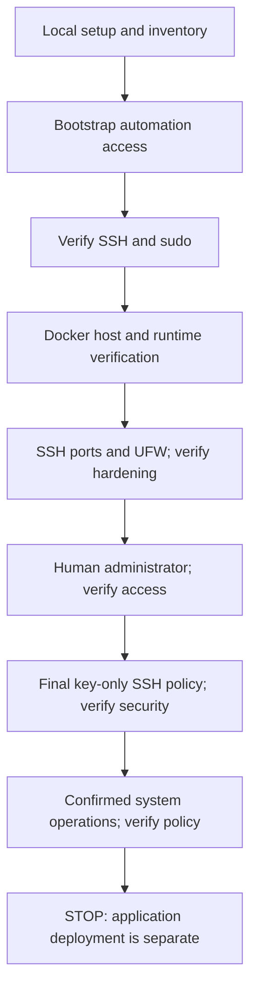

# Portfolio Server Infrastructure

[English](README.md) · [Русский](README.ru.md)

Portfolio Server Infrastructure prepares an Ubuntu VPS for a personal portfolio or other self-hosted applications. An interactive CLI runs Ansible stages, verifies access between changes and leaves you with a Docker-ready server, a host firewall, separate administrator access and a bounded system maintenance policy.

It is intended for operators who can review SSH and sudo permissions and recover a server through its provider console. Application deployment is a separate task: this repository does not deploy a website, reverse proxy, domains, TLS certificates or application networks.

## Features

- **Guided initialization:** `make init-server` coordinates bootstrap, Docker, hardening, human access, final SSH security and server operations, with independent verification between stages.
- **Ansible provisioning:** reviewable roles and idempotent configuration; converged provisioning avoids unnecessary changes and service restarts.
- **Docker host:** official Docker Engine packages, Compose and Buildx, bounded `local` container logs and a disposable runtime smoke test.
- **SSH and UFW:** validated listening ports, IPv4/IPv6 firewall rules and final key-only SSH with root, password and keyboard-interactive login disabled. Stock SSH service and socket activation modes are preserved.
- **User management:** separate human keys, explicit sudo policies, account/key inspection, additive key registration, exact key revocation and guarded account removal.
- **System maintenance:** Ubuntu security-origin unattended updates, bounded journald retention and stock maintenance timers, without automatic reboot or package removal.
- **Failure handling:** strict host trust, default-deny confirmations, unchanged-state checks, locks and pending activation evidence. Failures stop later stages; retained administrator/console access supports deliberate recovery.

## Architecture

The controller is your local computer; the managed host is the Ubuntu server. The CLI owns local keys, trust, confirmations and sequencing. Ansible roles apply server configuration; independent SSH and server inspectors verify it.



See [ARCHITECTURE.md](ARCHITECTURE.md) for module responsibilities and security boundaries, and the [operator guide](docs/operator-guide.md) for individual stage procedures.

## System requirements

| Component | Requirements |
| --- | --- |
| Controller | Linux x86_64 or arm64 with glibc; Git, Make, POSIX shell, curl, tar/gzip, coreutils including `sha256sum`, and OpenSSH clients (`ssh`, `ssh-keygen`, `ssh-keyscan`, `scp`, `sftp`) |
| Local tooling | Setup downloads pinned uv, managed Python 3.12, Ansible, Paramiko, collections and validation tools into the project. Preinstalled Python/uv, Go and sshpass are unnecessary |
| Managed host | Ubuntu Server with systemd, `/usr/bin/python3`, `python3-apt`, `/bin/bash`, sudo, `/usr/sbin/visudo` and an active `/etc/sudoers.d` include. Docker's release allowlist is Jammy 22.04, Noble 24.04 and Resolute 26.04; this is not an E2E acceptance claim for each release |
| Initial access | A fresh host with SSH password access as root, or an existing password-capable administrator with sudo. A verified provider host-key fingerprint, tested recovery console and a retained administrative session |
| Network | Controller access to dependency registries; server access to Ubuntu/Docker repositories and Docker Hub. Provider firewall rules must allow the intended SSH ports |
| Optional local E2E | Linux x86_64, hardware virtualization, KVM and system libvirt, at least 2 available CPU cores, 4 GiB guest RAM and space for a 25 GiB disk, image and snapshots |

Run Make as your normal controller user. `make setup` uses no sudo and installs no system packages. E2E preparation may offer separately confirmed host package/group/storage changes; read its [host requirements](docs/local-vm-e2e.md#host-preparation-explicit-operator-consent) first.

## Quick Start

This route is for a **fresh server**. Commands after local setup contact and may change the server (**LIVE**). Before approving a plan, review its target and permissions, allow SSH in the provider firewall and test provider-console recovery. For an already secured server, use the [migration procedure](docs/operator-guide.md#managed-user-configuration-and-migration) instead of password bootstrap.

### 1. Clone and prepare the controller

```bash
git clone https://github.com/DanilFaritovich/portfolio-server-infrastructure.git
cd portfolio-server-infrastructure
make setup
```

Accept the local dependency plan after review. Setup creates `inventories/production.yml` from the [example](inventories/production.example.yml) only when missing; it never overwrites an existing inventory. Tooling remains in `.tools/`, `.venv`, `.ansible/` and `.cache/`. Setup needs registry access, but never contacts a VPS.

### 2. Configure inventory

Edit the local `inventories/production.yml`, keeping its one-host structure. Replace `vps.example.invalid` with your server's exact hostname or IP and set its existing SSH port:

```yaml
all:
  children:
    bootstrap:
      hosts:
        portfolio:
          ansible_host: vps.example.invalid
          ansible_port: 22
          bootstrap_login_user: root
          ansible_user: ansible
          ansible_private_key_file: ~/.ssh/portfolio-server-infrastructure/ansible_ed25519
          ansible_python_interpreter: /usr/bin/python3
          ssh_listen_ports: [22]
          ssh_verify_ports: [22]
          firewall_allowed_tcp_ports: [80, 443]
```

Set the three access fields together: `bootstrap_login_user` is used only for initial password bootstrap; `ansible_user` and `ansible_private_key_file` select subsequent managed access. Choose an unused non-root automation account. Do not put passwords, key contents or unrelated variables in inventory, and keep real inventories out of Git.

Keep the current SSH port in `ssh_listen_ports` during a transition. `ssh_verify_ports` defaults to all listening ports and must include the current inventory port. Opening 80/443 does not install a web server. See [port migration and provider prerequisites](docs/operator-guide.md#host-hardening-stage-stage-3).

### 3. Prepare an independent human administrator key

Choose an unused account name, for example `portfolio_admin`:

```bash
make generate-user-key HUMAN_USER=portfolio_admin
make show-public-key HUMAN_USER=portfolio_admin
```

Generation preserves existing pairs and asks for a passphrase through OpenSSH. The default path is `~/.ssh/portfolio-infra/portfolio_admin_ed25519`. If using an encrypted key, ensure the invoking shell has an existing SSH agent and load it:

```bash
make load-user-key HUMAN_USER=portfolio_admin
```

If no agent is running, start one in your shell as described in the [key guide](docs/operator-guide.md#agent-loading-and-a-new-computer-with-one-encrypted-key). The CLI never starts one for you. The automation key is separate: bootstrap generates it if missing, without a passphrase, and never overwrites an existing pair. Both automation and `HUMAN_SUDO=admin` grant root-equivalent `NOPASSWD: ALL` access; protect the controller and keys accordingly.

### 4. Initialize the server

In an interactive terminal:

```bash
make init-server INIT_FROM=bootstrap HUMAN_USER=portfolio_admin HUMAN_SUDO=admin \
  HUMAN_KEY="$HOME/.ssh/portfolio-infra/portfolio_admin_ed25519" \
  HUMAN_PUBLIC_KEY="$HOME/.ssh/portfolio-infra/portfolio_admin_ed25519.pub"
```

Review the preliminary plan and recovery attestation. Default-deny approval covers only the listed operations in this invocation; native host-trust, password and passphrase prompts remain. On first connection, compare the displayed host fingerprint with the provider console/panel before trusting it. A network scan alone does not establish identity. The bootstrap password is entered through Ansible's native prompt and is not stored by the project.

Initialization verifies each stage before proceeding. Final SSH security requires independently proven human administrator and automation access. It disables root/password/keyboard-interactive SSH only after those proofs; Stage 5 configures scheduled security updates and log limits. No application deployment or reboot is included.

### 5. Verify the completed server

```bash
make init-server INIT_FROM=verify HUMAN_USER=portfolio_admin HUMAN_SUDO=admin \
  HUMAN_KEY="$HOME/.ssh/portfolio-infra/portfolio_admin_ed25519" \
  HUMAN_PUBLIC_KEY="$HOME/.ssh/portfolio-infra/portfolio_admin_ed25519.pub"
```

This verifies the full pipeline without provisioning. Docker verification creates/removes a smoke container and may populate the image cache. `make connect-user HUMAN_USER=portfolio_admin` opens an interactive human session after verification.

After an error, **stop and diagnose before continuing**. `INIT_FROM` also accepts `docker`, `hardening`, `human`, `ssh` or `operations`; earlier stages must pass fresh verification. Choosing a later stage is an explicit decision after diagnosis, not automatic recovery. See [interrupted stages](docs/operator-guide.md#interrupted-stages-and-safe-repetition).

## Command reference

These are actual [Makefile](Makefile) targets. Server commands use `INVENTORY=inventories/production.yml` by default. Local operations, offline checks and LIVE server/VM operations have different effects; verification is not always free of runtime changes.

### Controller and offline checks

| Command | Purpose / effect |
| --- | --- |
| `make setup` | Install local tooling and create missing inventory; registry access |
| `make deps` / `make deps-ci` | Install the same dependencies without inventory; interactive / explicit noninteractive CI mode |
| `make generate-user-key HUMAN_USER=NAME` | Generate a non-overwriting human key; optional loading into an existing agent |
| `make load-user-key HUMAN_USER=NAME` | Load the selected existing key into the local agent |
| `make show-public-key HUMAN_USER=NAME` / `make copy-public-key HUMAN_USER=NAME` | Display public key/fingerprint or copy public material; clipboard copying may offer package installation |
| `make show-controller` | Validate local key/trust and display inventory access |
| `make show-server-trust` / `make copy-server-trust` | Export existing verified host-trust JSON to terminal/clipboard; clipboard installation may be offered |
| `make trust-server` | Confirm local host-trust import; may separately offer a LIVE host-only proof on another port |
| `make check` / `make ci` | Aggregate offline checks, using example inventory and synthetic fixtures |
| `make lint-yaml` / `make lint-ansible` | YAML lint / offline Ansible lint |
| `make syntax-check` / `make lint-workflows` | Ansible syntax / GitHub Actions validation |
| `make test-access` | Offline Python test suite, including mocked E2E lifecycle |

### Server initialization and maintenance — LIVE

| Command | Purpose / effect |
| --- | --- |
| `make init-server` | Guided initialization or full verification; select `INIT_FROM` |
| `make bootstrap-user` / `make verify-access` | Create automation access / prove independent key-only SSH and sudo |
| `make docker-host` / `make verify-docker` | Provision Docker with postflight / runtime and disposable container checks |
| `make inspect-hardening` | Read-only Stage 3 safety report; FAIL blocks changes |
| `make harden` / `make verify-hardening` | Configure SSH ports/UFW / verify listeners, routes and firewall |
| `make add-user` / `make verify-user` | Register human access / prove the selected key and sudo policy |
| `make secure-ssh` / `make verify-ssh-security` | Apply final authentication policy / verify policy and independent access |
| `make inspect-operations` | Read-only system maintenance readiness report |
| `make setup-operations` / `make verify-operations` | Configure security updates, logs and timers / verify policy and services |
| `make preview-apt-policy` / `make apply-apt-policy` | LIVE check-diff / confirmed exact missing-line APT migration, with wider drift refused |
| `make reboot-host` | Confirm reboot; then verify access, Docker and Stage 3 hardening |
| `make connect-controller` / `make connect-user HUMAN_USER=NAME` | Interactive key-only SSH as the inventory controller / selected human |

### Users and keys — LIVE

| Command | Purpose / effect |
| --- | --- |
| `make list-users` | Read recorded human users and protected controller state |
| `make show-user HUMAN_USER=NAME` | Read identity, groups, sudo and key state |
| `make list-user-keys HUMAN_USER=NAME` | Read key fingerprints and managed ownership |
| `make add-user-key HUMAN_USER=NAME HUMAN_PUBLIC_KEY=/path/key.pub` | Add one explicit public key, preserving other entries |
| `make revoke-user-key HUMAN_USER=NAME KEY_FINGERPRINT=SHA256:...` | Revoke one exact managed key; separate recovery proof required |
| `make remove-user HUMAN_USER=NAME` | Revoke credentials/sudo and remove the account, retaining files; separate recovery proof required |

`add-user` requires `HUMAN_USER` and an explicit public file via `HUMAN_PUBLIC_KEY`, or pasted public input in a terminal. `HUMAN_SUDO=none|admin|restricted` selects rights; restricted policy requires `HUMAN_SUDO_COMMANDS`. Existing users accept additive keys, not privilege/group migration. Non-sudo supplementary groups require a rights review and exact `HUMAN_GROUPS_APPROVED` acceptance.

For destructive operations supply `RECOVERY_USER` and `RECOVERY_KEY` for a different, independently proven human administrator with disjoint keys. Root/current controller and unmanaged accounts/keys are protected. Removal is non-forced, retains home/mail/files and records a receipt that blocks recreation. See [user lifecycle and recovery](docs/operator-guide.md#user-and-ssh-key-management-stage-6-task-3).

### Local VM lifecycle — real local operations

| Command | Purpose / effect |
| --- | --- |
| `make e2e-list-distros` | LOCAL registry listing only |
| `make e2e-prepare` | Confirm host preparation and create a dedicated guest, NAT and stopped baseline |
| `make e2e-status` | Query fixture ownership/readiness without starting it |
| `make e2e-test E2E_FROM=bootstrap` | Initialize, verify, check repeat convergence and reboot persistence |
| `make e2e-reset` | Confirm graceful stop and restore the owned baseline |
| `make e2e-delete` | Confirm safe removal of owned fixture resources |
| `make e2e-list-users` / `make e2e-show-user` / `make e2e-list-user-keys` | Guarded read-only user inspection in the running guest |
| `make e2e-add-user` / `make e2e-verify-user` / `make e2e-add-user-key` | Guarded guest human access/key operations with the same `HUMAN_*` inputs |
| `make e2e-revoke-user-key` / `make e2e-remove-user` | Guarded guest revocation/removal with separate recovery proof |

## Testing and recorded results

Once dependencies are installed:

```bash
make check
```

Checks run YAML/Ansible/workflow lint, Ansible syntax validation and offline Python tests with synthetic fixtures and mocked SSH, downloads and hypervisor commands. They use the example inventory, require no production credentials and do not contact a server or launch a VM. [GitHub Actions](.github/workflows/ci.yml) runs `make deps-ci` followed by `make ci` on Ubuntu 24.04.

The following records the completed checks reported for [PR #11](https://github.com/DanilFaritovich/portfolio-server-infrastructure/pull/11) and the operator's subsequent confirmation supplied for this guide. The PR description confirms prepare/initialization and offline checks; it leaves the final repeat/reboot scenario pending. Those later results and user lifecycle/deletion are **operator-reported**, not new executions performed while editing this documentation. No test count or broader platform acceptance is inferred.

| Check | Recorded result / environment |
| --- | --- |
| `make check` / CI: lint, Ansible syntax, Python tests | Passed; PR evidence and GitHub Actions on Ubuntu 24.04 |
| E2E VM creation | Passed; Ubuntu Server 24.04 LTS guest; controller Ubuntu 26.04 according to the operator |
| Full initialization | Passed: bootstrap, Docker, hardening, human access, SSH security, server operations |
| Final verification, repeat execution and idempotency | Passed according to the operator; provisioning converged, smoke-test runtime changes remain expected |
| Guest reboot and re-verification | Passed according to the operator |
| User creation/SSH verification, key addition/revocation, user removal | Passed according to the operator |
| Safe E2E fixture deletion | Passed according to the operator |
| External production VPS | Outside the confirmed E2E run |

See the bilingual [validation record](docs/validation.md) for scope and evidence limits. Offline success alone does not prove live access, idempotency or provider recovery.

## E2E on a real Ubuntu VM

This optional interactive route creates a real local KVM/libvirt guest with isolated inventory, HOME, keys and host trust. It is outside offline checks and CI. Read the [full E2E operator guide](docs/local-vm-e2e.md) before approving host changes or creating a VM. The registry includes Ubuntu Server 24.04 LTS (default) and 22.04 LTS; the recorded complete run is 24.04.

### Prepare and run the full scenario

```bash
make deps
make e2e-list-distros
make e2e-prepare E2E_DISTRO=ubuntu-24.04
make e2e-status
make e2e-test E2E_FROM=bootstrap
```

Run each command only after the previous one succeeds. Preparation may need separately approved packages/groups/storage; ineffective new groups stop before VM creation and require a controller restart. Set a unique disposable root password. Use the printed console command to confirm cloud-init success, root console recovery and the guest host-key fingerprint as described in the [first-run procedure](docs/local-vm-e2e.md#prepare-and-first-run). Confirm graceful shutdown/baseline creation; readiness is bounded to 300 seconds and shutdown to 120 seconds. Partial preparation is retained for diagnosis.

The scenario creates `e2e_admin` with an independent key, runs the existing initialization CLI, verifies all stages, repeats convergence from Docker with provisioning `changed=0`, reboots the guest and verifies a new boot ID and server state. Native trust/authentication prompts remain; compare fingerprints with the guest console. Errors preserve the VM for diagnosis and never trigger automatic reset.

### Exercise users and keys

After a successful scenario, keep the guest running and the console available. Create two test-only keys on the controller; explicit paths remain under the isolated fixture HOME so deletion can validate them:

```bash
stand_keys="$HOME/.local/share/portfolio-e2e/home/.ssh"
make generate-user-key HUMAN_USER=alice HUMAN_KEY="$stand_keys/portfolio-infra/alice_ed25519"
make generate-user-key HUMAN_USER=alice HUMAN_KEY="$stand_keys/portfolio-infra/alice_extra_ed25519"
make e2e-list-users
make e2e-show-user HUMAN_USER=e2e_admin
make e2e-add-user HUMAN_USER=alice HUMAN_SUDO=none \
  HUMAN_PUBLIC_KEY="$stand_keys/portfolio-infra/alice_ed25519.pub"
make e2e-verify-user HUMAN_USER=alice HUMAN_SUDO=none \
  HUMAN_KEY="$stand_keys/portfolio-infra/alice_ed25519"
make e2e-add-user-key HUMAN_USER=alice \
  HUMAN_PUBLIC_KEY="$stand_keys/portfolio-infra/alice_extra_ed25519.pub"
make e2e-verify-user HUMAN_USER=alice HUMAN_SUDO=none \
  HUMAN_KEY="$stand_keys/portfolio-infra/alice_extra_ed25519"
make e2e-list-user-keys HUMAN_USER=alice
```

Load encrypted keys in the existing agent before verification. Copy the extra key's exact fingerprint from the listing into the revocation command; use the scenario administrator for independent recovery:

```bash
make e2e-revoke-user-key HUMAN_USER=alice KEY_FINGERPRINT='SHA256:REPLACE_FROM_LISTING' \
  RECOVERY_USER=e2e_admin RECOVERY_KEY="$stand_keys/human/admin_ed25519"
```

A fresh `e2e-verify-user` with the extra key must now fail; the original key must still pass. Revocation does not terminate existing sessions. Stop after unexpected errors. Close Alice's sessions/processes before removal:

```bash
make e2e-remove-user HUMAN_USER=alice \
  RECOVERY_USER=e2e_admin RECOVERY_KEY="$stand_keys/human/admin_ed25519"
make e2e-list-users
make e2e-status
make e2e-delete
```

User wrappers neither start nor reset the VM. Deletion requires default-deny consent, ownership/path revalidation and graceful stopped-state checks; it does not uninstall host packages or undo group membership. For reset, partial fixtures and diagnostic snapshots, follow [recovery instructions](docs/local-vm-e2e.md#reset-deletion-and-incomplete-preparation).

## Compatibility

| Platform | Status / limits |
| --- | --- |
| Linux controller, glibc x86_64/arm64 | Implemented local toolchain path. Operator reports the full local run on Ubuntu 26.04; this does not establish acceptance on every Linux distribution or architecture |
| Ubuntu Server | Docker allows 22.04/24.04/26.04 subject to all stage preflights. Confirmed complete E2E guest: Ubuntu Server 24.04 LTS amd64 |
| Windows through WSL2 | **Not tested.** Requires the Linux prerequisites; agent, paths, clipboard and networking need independent checks. No KVM/libvirt E2E acceptance is claimed |
| Native Windows / macOS controller | Full setup is unsupported by the Linux-only toolchain installer. A macOS clipboard backend does not imply full platform support |
| Other server OS / custom host configurations | Outside the implemented Ubuntu pipeline; custom SSH/systemd/UFW/Docker policies may be refused by safety preflight |

E2E host eligibility is based on Linux x86_64/KVM/libvirt capabilities rather than a host release allowlist. Automatic missing-package installation is restricted to reviewed Ubuntu/Debian APT environments; other systems require manual prerequisites. A registry entry or code allowlist does not prove a successful end-to-end run.

## Security, limitations and recovery

Keep inventories, private keys, passwords and diagnostic logs out of Git. Only public keys are transferred; private material stays with its owner. SSH transports pin the selected identity, require existing strict host trust and disable forwarding/client-config overrides. Encrypted identities must be loaded in the invoking shell's agent. Trust transfer is separately confirmed and never replaces conflicting host keys.

The automation account and human administrators have root-equivalent sudo. Public-key registration alone cannot prove login; independently verify the matching identity before final SSH policy or destructive changes. Review supplementary group rights explicitly. Keep a tested provider console and retained administrator session throughout security changes.

Idempotency applies to supported, unchanged managed state. Unsafe drift, unmanaged accounts/configuration, conflicting runtime packages, ambiguous UFW/SSH state and pending activation block changes. The project does not automatically uninstall conflicting packages, reset UFW, adopt accounts, clear receipts, downgrade SSH policy, roll back an interrupted pipeline or prune data. SSH loss does not prove that remote work stopped; diagnose before retrying. The local CLI lock serializes one controller user, while other computers and raw Ansible need manual coordination.

UFW host-input policy does not by itself protect Docker-published container ports. Review provider and container networking before separate application deployment. Security updates can restart services later through package scripts; Stage 5 does not reboot automatically. Limits on Docker/journald logs do not cap every application file.

Use these references before operating on a server:

- [Stage contracts, security policies and diagnostics](docs/operator-guide.md).
- [Interrupted activation, pending markers and recovery](docs/operator-guide.md#interrupted-stages-and-safe-repetition).
- [SSH trust transfer and a second controller](docs/operator-guide.md#transfer-server-trust-to-a-second-computer).
- [Managed inventory migration](docs/operator-guide.md#managed-user-configuration-and-migration).
- [Manual LIVE integration checklist](docs/operator-guide.md#stage-6-integration-manual-live-checklist).
- [Local VM console, snapshots and recovery](docs/local-vm-e2e.md).

## Project structure

| Path | Responsibility |
| --- | --- |
| `scripts/access.py`, `scripts/portfolio_cli/` | Compatible CLI entry point and controller implementation |
| `scripts/e2e.py` | Isolated local VM lifecycle entry point |
| `scripts/setup.sh` | Project-local dependency/toolchain setup |
| `scripts/user_management.py`, `library/` | Server-side user engine and inspectors/modules |
| `playbooks/`, `roles/` | Stage application and verification through Ansible |
| `plugins/connection/` | Pinned password-only bootstrap transport |
| `inventories/production.example.yml` | Committed inventory example; actual inventories stay local |
| `tests/`, `.github/workflows/ci.yml` | Offline regression checks and CI |
| `docs/`, `ARCHITECTURE.md` | Operator procedures, validation evidence and architecture |

## License

[MIT License](LICENSE), copyright © 2026 Danil Miftakhov.
