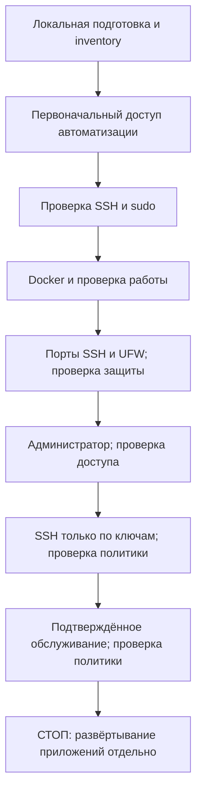

# Portfolio Server Infrastructure

[English](README.md) | **Русский**

[](https://www.python.org/)
[](https://docs.ansible.com/ansible-core/2.18/)
[](https://docs.docker.com/engine/)
[](https://ubuntu.com/server)
[](https://github.com/DanilFaritovich/portfolio-server-infrastructure/actions/workflows/ci.yml)
[](LICENSE)

Portfolio Server Infrastructure подготавливает VPS на Ubuntu для личного портфолио или других самостоятельно размещаемых приложений. Интерактивный CLI запускает этапы Ansible, проверяет доступ между изменениями и настраивает сервер с Docker, межсетевым экраном, отдельным доступом администратора и ограниченной политикой системного обслуживания.

Проект предназначен для операторов, которые готовы оценивать права SSH и sudo и восстанавливать сервер через консоль провайдера. Развёртывание приложений выполняется отдельно: репозиторий не устанавливает сайт, обратный прокси, домены, сертификаты TLS или сети приложений.

## Возможности

- **Пошаговая инициализация:** `make init-server` объединяет первоначальную настройку доступа, Docker, защиту хоста, создание администратора, финальную защиту SSH и системное обслуживание с независимыми проверками между этапами.
- **Настройка через Ansible:** проверяемые роли и идемпотентная конфигурация; повторный запуск на настроенном сервере избегает лишних изменений и перезапусков служб.
- **Docker:** официальные пакеты Docker Engine, Compose и Buildx, ограниченные журналы контейнеров с драйвером `local` и проверка запуска временного контейнера.
- **SSH и UFW:** проверка портов SSH, правила межсетевого экрана для IPv4/IPv6 и финальный доступ только по ключам с отключением root, паролей и keyboard-interactive. Сохраняется штатный режим активации SSH через службу или сокет.
- **Управление пользователями:** отдельные человеческие ключи, явные политики sudo, просмотр учётных записей и ключей, добавление ключей, точный отзыв и защищённое удаление пользователей.
- **Системное обслуживание:** автоматические обновления из Ubuntu security, ограничение журналов journald и штатные таймеры обслуживания, без автоматической перезагрузки и удаления пакетов.
- **Обработка ошибок:** строгое доверие к ключу хоста, подтверждения с отказом по умолчанию, проверка неизменности состояния, блокировки и маркеры незавершённой активации. Ошибка останавливает следующие этапы; сохранённый доступ администратора и консоль позволяют восстановить сервер осознанно.

## Технологический стек

| Технология | Назначение в проекте |
| --- | --- |
| Python 3.12 | Управляемый проектом runtime контроллера для CLI, проверок и локальной VM; сервер использует собственный `/usr/bin/python3` |
| Ansible Core 2.18.6 · `ansible.posix` 2.0.0 | Отдельные роли настройки и playbook проверки каждого этапа сервера |
| OpenSSH · Paramiko 5.0.0 | Управляемый доступ только по ключам и независимые проверки; закреплённый транспорт первоначального входа по паролю и подписанные проверки доверия к хосту |
| Docker Engine · Compose · Buildx | Официальные серверные пакеты, ограниченные журналы контейнеров и проверка запуска; версии поступают из APT-репозитория Docker |
| Ubuntu · systemd · UFW | Целевая ОС, активация SSH через службу/сокет, межсетевой экран, journald и таймеры обновлений безопасности |
| uv 0.12.23 · Make | Установка локальных инструментов с проверкой контрольных сумм и единый интерфейс команд |
| ansible-lint 25.5.0 · yamllint 1.38.0 · actionlint 1.7.7 · unittest | Offline-проверки конфигурации, workflow и регрессионные тесты контроллера |
| KVM/QEMU · libvirt · cloud-init | Необязательная изолированная локальная Ubuntu VM для интеграционных прогонов оператором |

Версии инструментов контроллера закреплены в [requirements-dev.txt](requirements-dev.txt), [collections.yml](collections.yml) и [скриптах установки](scripts/setup.sh). Ограничения серверных релизов и результаты проверки платформ приведены в разделе [совместимости](#совместимость); CI работает на Ubuntu 24.04.

## Архитектура

Контроллер — ваш локальный компьютер, управляемый хост — сервер Ubuntu. CLI отвечает за локальные ключи, доверие, подтверждения и порядок действий. Роли Ansible применяют конфигурацию; независимые подключения SSH и серверные инспекторы проверяют результат.



| Граница | Ответственность |
| --- | --- |
| Локальный контроллер: `scripts/access.py` → `portfolio_cli` | Проверка входных данных, выбор ключей, доверие к хосту, подтверждение планов и последовательный запуск этапов |
| Управляемый VPS: `playbooks/` и `roles/` | Применение выбранного этапа через Ansible; серверные `library/` и `scripts/user_management.py` остаются отдельными компонентами |
| Независимая проверка: SSH и потоковые инспекторы | Доказательство доступа и фактического состояния сервера; инспекторы без изменений передаются через stdin без файлов на сервере |
| Необязательная локальная VM: `scripts/e2e.py` → существующий CLI | Управление изолированными гостем/NAT/снимками и защита запуска сценария; повторное использование этапов настройки и проверки |

Ответственность модулей и границы безопасности описаны в [ARCHITECTURE.md](ARCHITECTURE.md), процедуры отдельных этапов — в [руководстве оператора](docs/operator-guide.ru.md).

## Ключевые инженерные решения

| Решение | Причина и следствие |
| --- | --- |
| Отделить изменения от независимой проверки | Успешный recap Ansible сам по себе не доказывает возможность будущего входа. Свежие проверки SSH по ключу/sudo и состояния этапа определяют возможность следующих операций |
| Явно управлять переходами аутентификации | Первоначальный вход по паролю, автоматизация и человеческое администрирование используют отдельные пути доступа. Финальные ограничения SSH требуют доказанного независимого доступа администратора и подтверждения восстановления |
| Проверять конфигурацию до активации | Полный кандидат SSH и фактические слушатели проверяются до активации. Маркеры Docker, SSH Stage 3 и journald сохраняют свидетельство незавершённой активации |
| Блокировать опасный дрейф вместо автоматического исправления | Предварительные проверки отклоняют неуправляемое или неоднозначное состояние; реестры принадлежности, снимки и блокировки ограничивают согласованные изменения. Перед явным продолжением оператор диагностирует ошибку |
| Устанавливать инструменты локально | Закреплённые зависимости и установщики с проверкой контрольных сумм исключают необходимость системных Python/uv и обеспечивают общий набор инструментов для Make и дочерних процессов Ansible |
| Повторно использовать рабочий процесс в изолированном E2E | Сценарии VM вызывают существующие команды инициализации/перезагрузки с обычными подтверждениями. Offline-тесты имитируют внешние команды; реальные VM и production проверяет оператор отдельно |

## Документация и маршруты работы

Для нового VPS начните с [быстрого старта](#быстрый-старт), затем используйте [справочник команд](#справочник-команд) для отдельных операций. Перед LIVE-изменениями изучите [безопасность и восстановление](#безопасность-ограничения-и-восстановление).

- [Руководство оператора](docs/operator-guide.ru.md): подробные контракты этапов, миграция inventory, перенос ключей/доверия и восстановление.
- [Архитектура](ARCHITECTURE.md): ответственность модулей, зависимости и границы безопасности.
- [Руководство локального VM E2E](docs/local-vm-e2e.md): подготовка хоста, проверки через консоль, снимки и жизненный цикл стенда.
- [Отчёт о проверках](docs/validation.ru.md): результаты offline-проверок и прогонов оператора с границами подтверждений.

## Системные требования

| Компонент | Требования |
| --- | --- |
| Контроллер | Linux x86_64 или arm64 с glibc; Git, Make, POSIX shell, curl, tar/gzip, coreutils с `sha256sum` и клиенты OpenSSH (`ssh`, `ssh-keygen`, `ssh-keyscan`, `scp`, `sftp`) |
| Локальные инструменты | Setup загружает закреплённые версии uv, управляемый Python 3.12, Ansible, Paramiko, коллекции и инструменты проверки внутрь проекта. Предустановленные Python/uv, Go и sshpass не нужны |
| Управляемый хост | Ubuntu Server с systemd, `/usr/bin/python3`, `python3-apt`, `/bin/bash`, sudo, `/usr/sbin/visudo` и активным включением `/etc/sudoers.d`. Роль Docker допускает Jammy 22.04, Noble 24.04 и Resolute 26.04; это не означает подтверждённый E2E-прогон каждой версии |
| Первоначальный доступ | Новый хост с доступом root по паролю SSH либо существующий администратор с паролем и sudo. Подтверждённый fingerprint ключа хоста от провайдера, проверенная консоль восстановления и сохранённая административная сессия |
| Сеть | Контроллеру нужен доступ к реестрам зависимостей; серверу — к репозиториям Ubuntu/Docker и Docker Hub. Межсетевой экран провайдера должен пропускать нужные порты SSH |
| Необязательный локальный E2E | Linux x86_64, аппаратная виртуализация, KVM и системный libvirt, минимум 2 доступных ядра, 4 ГиБ памяти для гостя и место для диска 25 ГиБ, образа и снимков |

Запускайте Make от обычного пользователя контроллера. `make setup` не использует sudo и не устанавливает системные пакеты. Подготовка E2E может предложить отдельно подтверждаемые изменения пакетов, групп и хранилища; сначала изучите [требования к хосту](docs/local-vm-e2e.md#host-preparation-explicit-operator-consent).

## Быстрый старт

Этот маршрут предназначен для **нового сервера**. Команды после локальной подготовки обращаются к серверу и могут менять его (**LIVE**). До подтверждения плана проверьте адрес и права, разрешите SSH в межсетевом экране провайдера и проверьте восстановление через его консоль. Для уже защищённого сервера используйте [процедуру миграции](docs/operator-guide.ru.md#настройка-рабочего-пользователя-и-миграция), а не первоначальную настройку по паролю.

### 1. Клонируйте проект и подготовьте контроллер

```bash
git clone https://github.com/DanilFaritovich/portfolio-server-infrastructure.git
cd portfolio-server-infrastructure
make setup
```

Изучите и подтвердите локальный план установки зависимостей. Setup создаёт `inventories/production.yml` из [примера](inventories/production.example.yml), только если файл отсутствует, и никогда не перезаписывает существующий inventory. Инструменты остаются в `.tools/`, `.venv`, `.ansible/` и `.cache/`. Setup требует доступа к реестрам, но не обращается к VPS.

### 2. Настройте inventory

Отредактируйте локальный `inventories/production.yml`, сохранив структуру с одним хостом. Замените `vps.example.invalid` точным именем или IP сервера и укажите существующий порт SSH:

```yaml
all:
  children:
    bootstrap:
      hosts:
        portfolio:
          ansible_host: vps.example.invalid
          ansible_port: 22
          bootstrap_login_user: root
          ansible_user: ansible
          ansible_private_key_file: ~/.ssh/portfolio-server-infrastructure/ansible_ed25519
          ansible_python_interpreter: /usr/bin/python3
          ssh_listen_ports: [22]
          ssh_verify_ports: [22]
          firewall_allowed_tcp_ports: [80, 443]
```

Задавайте три поля доступа вместе: `bootstrap_login_user` используется только для первоначального подключения по паролю, а `ansible_user` и `ansible_private_key_file` определяют последующий управляемый доступ. Выберите свободное имя пользователя автоматизации, отличное от root. Не помещайте в inventory пароли, содержимое ключей и посторонние переменные; реальные inventory не должны попадать в Git.

При смене портов сохраняйте текущий порт SSH в `ssh_listen_ports`. По умолчанию `ssh_verify_ports` проверяет все слушающие порты и должен включать текущий порт inventory. Открытие 80/443 не устанавливает веб-сервер. См. [смену портов и требования к сети провайдера](docs/operator-guide.ru.md#host-hardening-stage-3).

### 3. Подготовьте независимый ключ администратора

Выберите свободное имя учётной записи, например `portfolio_admin`:

```bash
make generate-user-key HUMAN_USER=portfolio_admin
make show-public-key HUMAN_USER=portfolio_admin
```

Генерация сохраняет существующие пары и запрашивает парольную фразу через OpenSSH. Путь по умолчанию — `~/.ssh/portfolio-infra/portfolio_admin_ed25519`. Для зашифрованного ключа убедитесь, что в текущей оболочке доступен существующий SSH agent, и загрузите ключ:

```bash
make load-user-key HUMAN_USER=portfolio_admin
```

Если agent не запущен, запустите его в своей оболочке по [инструкции для ключей](docs/operator-guide.ru.md#загрузка-в-agent-и-новый-компьютер-с-одним-зашифрованным-ключом). CLI не запускает agent самостоятельно. Ключ автоматизации отдельный: bootstrap создаёт его при отсутствии, без парольной фразы, и не перезаписывает существующую пару. Автоматизация и `HUMAN_SUDO=admin` получают эквивалентные root права `NOPASSWD: ALL`; защищайте контроллер и ключи соответственно.

### 4. Инициализируйте сервер

В интерактивном терминале:

```bash
make init-server INIT_FROM=bootstrap HUMAN_USER=portfolio_admin HUMAN_SUDO=admin \
  HUMAN_KEY="$HOME/.ssh/portfolio-infra/portfolio_admin_ed25519" \
  HUMAN_PUBLIC_KEY="$HOME/.ssh/portfolio-infra/portfolio_admin_ed25519.pub"
```

Изучите предварительный план и подтвердите доступность восстановления. Подтверждение с отказом по умолчанию распространяется только на перечисленные действия текущего запуска; штатные запросы доверия к хосту, пароля и парольной фразы сохраняются. При первом подключении сравните показанный fingerprint с консолью или панелью провайдера до принятия доверия. Сетевой опрос сам по себе не подтверждает личность сервера. Пароль bootstrap вводится в штатном запросе Ansible и не сохраняется проектом.

Инициализация проверяет каждый этап до перехода к следующему. Финальная защита SSH требует независимого доказательства доступа администратора и автоматизации. Только после этих проверок отключаются root, пароль и keyboard-interactive в SSH; Stage 5 настраивает плановые обновления безопасности и ограничения журналов. Развёртывание приложений и перезагрузка не выполняются.

### 5. Проверьте готовый сервер

```bash
make init-server INIT_FROM=verify HUMAN_USER=portfolio_admin HUMAN_SUDO=admin \
  HUMAN_KEY="$HOME/.ssh/portfolio-infra/portfolio_admin_ed25519" \
  HUMAN_PUBLIC_KEY="$HOME/.ssh/portfolio-infra/portfolio_admin_ed25519.pub"
```

Команда проверяет все этапы без применения конфигурации. Проверка Docker создаёт и удаляет временный контейнер и может заполнить кеш образов. После проверки `make connect-user HUMAN_USER=portfolio_admin` открывает интерактивную сессию администратора.

При ошибке **остановитесь и проведите диагностику до продолжения**. `INIT_FROM` также принимает `docker`, `hardening`, `human`, `ssh` и `operations`; предыдущие этапы должны пройти свежую проверку. Выбор более позднего этапа — явное решение после диагностики, а не автоматическое восстановление. См. [прерывания этапов](docs/operator-guide.ru.md#прерывания-этапов-и-безопасный-повтор).

## Справочник команд

Здесь перечислены реальные цели [Makefile](Makefile). По умолчанию серверные команды используют `INVENTORY=inventories/production.yml`. Локальные действия, offline-проверки и LIVE-операции с сервером или VM имеют разные последствия; проверка не всегда обходится без изменений во время выполнения.

### Контроллер и offline-проверки

| Команда | Назначение и последствия |
| --- | --- |
| `make setup` | Установка локальных инструментов и создание отсутствующего inventory; доступ к реестрам |
| `make deps` / `make deps-ci` | Те же зависимости без inventory; интерактивный режим / явный неинтерактивный режим CI |
| `make generate-user-key HUMAN_USER=NAME` | Создание человеческого ключа без перезаписи; необязательная загрузка в существующий agent |
| `make load-user-key HUMAN_USER=NAME` | Загрузка выбранного существующего ключа в локальный agent |
| `make show-public-key HUMAN_USER=NAME` / `make copy-public-key HUMAN_USER=NAME` | Вывод публичного ключа/fingerprint или копирование публичных данных; возможное предложение установки утилиты буфера обмена |
| `make show-controller` | Локальная проверка ключа и доверия, вывод доступа из inventory |
| `make show-server-trust` / `make copy-server-trust` | Экспорт существующего проверенного доверия к хосту в JSON в терминал/буфер; возможная установка утилиты буфера |
| `make trust-server` | Подтверждённый локальный импорт доверия; отдельное предложение LIVE-проверки только хоста на другом порту |
| `make check` / `make ci` | Общие offline-проверки с примером inventory и синтетическими данными |
| `make lint-yaml` / `make lint-ansible` | Проверка YAML / offline Ansible lint |
| `make syntax-check` / `make lint-workflows` | Проверка синтаксиса Ansible / GitHub Actions |
| `make test-access` | Offline Python-тесты, включая имитацию жизненного цикла E2E |

### Инициализация и обслуживание сервера — LIVE

| Команда | Назначение и последствия |
| --- | --- |
| `make init-server` | Пошаговая инициализация или полная проверка; этап задаётся через `INIT_FROM` |
| `make bootstrap-user` / `make verify-access` | Создание доступа автоматизации / независимая проверка SSH по ключу и sudo |
| `make docker-host` / `make verify-docker` | Установка Docker с итоговой проверкой / проверка работы и временного контейнера |
| `make inspect-hardening` | Отчёт о безопасности Stage 3 без изменений; FAIL блокирует применение |
| `make harden` / `make verify-hardening` | Настройка портов SSH и UFW / проверка слушателей, маршрутов и межсетевого экрана |
| `make add-user` / `make verify-user` | Регистрация человеческого доступа / проверка выбранного ключа и политики sudo |
| `make secure-ssh` / `make verify-ssh-security` | Применение финальной политики аутентификации / проверка политики и независимого доступа |
| `make inspect-operations` | Проверка готовности системного обслуживания без изменений |
| `make setup-operations` / `make verify-operations` | Настройка обновлений безопасности, журналов и таймеров / проверка политики и служб |
| `make preview-apt-policy` / `make apply-apt-policy` | LIVE check-diff / подтверждённая миграция одной отсутствующей строки APT; более широкий дрейф блокируется |
| `make reboot-host` | Подтверждённая перезагрузка; затем проверка доступа, Docker и защиты Stage 3 |
| `make connect-controller` / `make connect-user HUMAN_USER=NAME` | Интерактивный SSH по ключу от контроллера из inventory / выбранного пользователя |

### Пользователи и ключи — LIVE

| Команда | Назначение и последствия |
| --- | --- |
| `make list-users` | Просмотр зарегистрированных пользователей и защищённого состояния контроллера |
| `make show-user HUMAN_USER=NAME` | Просмотр учётной записи, групп, sudo и ключей |
| `make list-user-keys HUMAN_USER=NAME` | Просмотр fingerprint ключей и принадлежности управляемых записей |
| `make add-user-key HUMAN_USER=NAME HUMAN_PUBLIC_KEY=/path/key.pub` | Добавление одного явно указанного публичного ключа с сохранением остальных |
| `make revoke-user-key HUMAN_USER=NAME KEY_FINGERPRINT=SHA256:...` | Точный отзыв управляемого ключа; требуется отдельное доказательство recovery-доступа |
| `make remove-user HUMAN_USER=NAME` | Отзыв доступа/sudo и удаление учётной записи с сохранением файлов; требуется отдельный recovery-доступ |

`add-user` требует `HUMAN_USER` и явный публичный файл через `HUMAN_PUBLIC_KEY` либо вставку публичного ключа в терминале. `HUMAN_SUDO=none|admin|restricted` задаёт права; ограниченная политика требует `HUMAN_SUDO_COMMANDS`. Для существующих пользователей поддерживается добавление ключей, но не миграция прав или групп. Дополнительные группы, кроме sudo, требуют проверки прав и точного согласия через `HUMAN_GROUPS_APPROVED`.

Для разрушительных операций задайте `RECOVERY_USER` и `RECOVERY_KEY` другого независимо проверенного человеческого администратора с непересекающимися ключами. Root, текущий контроллер и неуправляемые учётные записи/ключи защищены. Удаление не принудительное: домашний каталог, почта и файлы сохраняются, а специальная запись блокирует повторное создание. См. [управление пользователями и восстановление](docs/operator-guide.ru.md#управление-пользователями-и-ssh-ключами-stage-6-задача-3).

### Локальная VM — реальные локальные операции

| Команда | Назначение и последствия |
| --- | --- |
| `make e2e-list-distros` | Только LOCAL-просмотр реестра образов |
| `make e2e-prepare` | Подтверждённая подготовка хоста и создание отдельного гостя, NAT и остановленного базового снимка |
| `make e2e-status` | Запрос принадлежности и готовности стенда без его запуска |
| `make e2e-test E2E_FROM=bootstrap` | Инициализация, проверка, повторная сходимость и сохранение состояния после перезагрузки |
| `make e2e-reset` | Подтверждённая корректная остановка и восстановление собственного базового снимка |
| `make e2e-delete` | Подтверждённое безопасное удаление ресурсов стенда |
| `make e2e-list-users` / `make e2e-show-user` / `make e2e-list-user-keys` | Защищённый просмотр пользователей в работающем госте без изменений |
| `make e2e-add-user` / `make e2e-verify-user` / `make e2e-add-user-key` | Защищённые операции доступа/ключей в госте с теми же параметрами `HUMAN_*` |
| `make e2e-revoke-user-key` / `make e2e-remove-user` | Защищённый отзыв/удаление в госте с отдельной проверкой recovery-доступа |

## Тестирование и подтверждённые результаты

После установки зависимостей:

```bash
make check
```

Проверки включают YAML/Ansible/workflow lint, синтаксис Ansible и offline Python-тесты с синтетическими данными и имитацией SSH, загрузок и команд гипервизора. Используется пример inventory, production-доступ не требуется, подключение к серверу и запуск VM не выполняются. [GitHub Actions](.github/workflows/ci.yml) запускает `make deps-ci`, затем `make ci` на Ubuntu 24.04.

Ниже приведены результаты из [PR #11](https://github.com/DanilFaritovich/portfolio-server-infrastructure/pull/11) и последующее подтверждение оператора, предоставленное для этого руководства. Описание PR подтверждает подготовку/инициализацию и offline-проверки, но оставляет финальный повторный прогон с перезагрузкой ожидающим проверки. Эти более поздние результаты, управление пользователями и удаление **подтверждены оператором**, а не заново выполнены при редактировании документации. Количество тестов и более широкая совместимость из них не выводятся.

| Проверка | Результат и окружение |
| --- | --- |
| `make check` / CI: линтеры, синтаксис Ansible, Python-тесты | Успешно; данные PR и GitHub Actions на Ubuntu 24.04 |
| Создание E2E-VM | Успешно; Ubuntu Server 24.04 LTS в госте; контроллер Ubuntu 26.04 со слов оператора |
| Полная инициализация | Успешно: bootstrap, Docker, hardening, human access, SSH security, server operations |
| Финальная проверка, повторное выполнение и идемпотентность | Успешно со слов оператора; конфигурация сошлась, изменения временного Docker-теста остаются ожидаемыми |
| Перезагрузка гостя и повторная проверка | Успешно со слов оператора |
| Создание пользователя/проверка SSH, добавление/отзыв ключей, удаление пользователя | Успешно со слов оператора |
| Безопасное удаление E2E-стенда | Успешно со слов оператора |
| Внешний production VPS | Не входит в подтверждённый E2E-прогон |

Границы прогона и подтверждений описаны в двуязычном [отчёте о проверках](docs/validation.ru.md). Успех offline-проверок сам по себе не доказывает реальный доступ, идемпотентность или восстановление через провайдера.

## E2E на реальной Ubuntu VM

Этот необязательный интерактивный маршрут создаёт настоящего локального гостя KVM/libvirt с изолированными inventory, HOME, ключами и доверием к хосту. Он не входит в offline-проверки и CI. Прочитайте [подробное руководство E2E](docs/local-vm-e2e.md) до подтверждения изменений хоста и создания VM. Реестр содержит Ubuntu Server 24.04 LTS (по умолчанию) и 22.04 LTS; подтверждённый полный прогон выполнен на 24.04.

### Подготовьте стенд и запустите полный сценарий

```bash
make deps
make e2e-list-distros
make e2e-prepare E2E_DISTRO=ubuntu-24.04
make e2e-status
make e2e-test E2E_FROM=bootstrap
```

Переходите к следующей команде только после успеха предыдущей. Подготовка может потребовать отдельно согласованных пакетов, групп и хранилища; неактивные новые группы останавливают работу до создания VM и требуют перезагрузки контроллера. Задайте уникальный временный пароль root. По выведенной команде консоли подтвердите успех cloud-init, восстановление через root-консоль и fingerprint гостевого ключа хоста согласно [процедуре первого запуска](docs/local-vm-e2e.md#prepare-and-first-run). Подтвердите корректное выключение и создание базового снимка; ожидание готовности ограничено 300 секундами, выключения — 120. Незавершённая подготовка сохраняется для диагностики.

Сценарий создаёт `e2e_admin` с независимым ключом, запускает существующий CLI инициализации, проверяет все этапы, повторяет настройку начиная с Docker с требованием `changed=0`, перезагружает гостя и проверяет новый boot ID и состояние сервера. Штатные запросы доверия и аутентификации сохраняются; сравнивайте fingerprint с консолью гостя. Ошибки сохраняют VM для диагностики и не запускают автоматический сброс.

### Проверьте пользователей и ключи

После успешного сценария оставьте гостя работающим и сохраните доступ к консоли. Создайте два тестовых ключа на контроллере; явные пути остаются внутри изолированного HOME стенда, чтобы удаление могло их проверить:

```bash
stand_keys="$HOME/.local/share/portfolio-e2e/home/.ssh"
make generate-user-key HUMAN_USER=alice HUMAN_KEY="$stand_keys/portfolio-infra/alice_ed25519"
make generate-user-key HUMAN_USER=alice HUMAN_KEY="$stand_keys/portfolio-infra/alice_extra_ed25519"
make e2e-list-users
make e2e-show-user HUMAN_USER=e2e_admin
make e2e-add-user HUMAN_USER=alice HUMAN_SUDO=none \
  HUMAN_PUBLIC_KEY="$stand_keys/portfolio-infra/alice_ed25519.pub"
make e2e-verify-user HUMAN_USER=alice HUMAN_SUDO=none \
  HUMAN_KEY="$stand_keys/portfolio-infra/alice_ed25519"
make e2e-add-user-key HUMAN_USER=alice \
  HUMAN_PUBLIC_KEY="$stand_keys/portfolio-infra/alice_extra_ed25519.pub"
make e2e-verify-user HUMAN_USER=alice HUMAN_SUDO=none \
  HUMAN_KEY="$stand_keys/portfolio-infra/alice_extra_ed25519"
make e2e-list-user-keys HUMAN_USER=alice
```

Перед проверкой загрузите зашифрованные ключи в существующий agent. Скопируйте точный fingerprint дополнительного ключа из списка в команду отзыва; для независимого восстановления используйте администратора сценария:

```bash
make e2e-revoke-user-key HUMAN_USER=alice KEY_FINGERPRINT='SHA256:REPLACE_FROM_LISTING' \
  RECOVERY_USER=e2e_admin RECOVERY_KEY="$stand_keys/human/admin_ed25519"
```

Свежая `e2e-verify-user` с дополнительным ключом теперь должна завершиться отказом, а с исходным — успешно. Отзыв не завершает существующие сессии. При неожиданных ошибках остановитесь. Перед удалением закройте сессии и процессы Alice:

```bash
make e2e-remove-user HUMAN_USER=alice \
  RECOVERY_USER=e2e_admin RECOVERY_KEY="$stand_keys/human/admin_ed25519"
make e2e-list-users
make e2e-status
make e2e-delete
```

Обёртки управления пользователями не запускают и не сбрасывают VM. Удаление требует подтверждения с отказом по умолчанию, повторной проверки принадлежности/путей и корректной остановки; оно не удаляет пакеты хоста и не отменяет членство в группах. Для сброса, незавершённых стендов и диагностических снимков следуйте [инструкциям восстановления](docs/local-vm-e2e.md#reset-deletion-and-incomplete-preparation).

## Совместимость

| Платформа | Статус и ограничения |
| --- | --- |
| Linux-контроллер, glibc x86_64/arm64 | Реализована локальная установка инструментов. Оператор подтверждает полный локальный прогон на Ubuntu 26.04; это не доказывает работу на каждом дистрибутиве или архитектуре Linux |
| Ubuntu Server | Docker допускает 22.04/24.04/26.04 при прохождении всех предварительных проверок. Подтверждённый полный E2E-гость: Ubuntu Server 24.04 LTS amd64 |
| Windows через WSL2 | **Не проверялось.** Нужны Linux-зависимости; agent, пути, буфер обмена и сеть требуют независимых проверок. Подтверждённого E2E с KVM/libvirt нет |
| Нативные Windows / macOS как контроллер | Полная установка не поддерживается установщиком инструментов, рассчитанным только на Linux. Наличие macOS-бэкенда буфера обмена не означает поддержку всей платформы |
| Другие серверные ОС / нестандартная конфигурация хоста | За пределами реализованного Ubuntu-конвейера; нестандартные политики SSH/systemd/UFW/Docker могут блокироваться предварительной проверкой безопасности |

Пригодность E2E-хоста определяется возможностями Linux x86_64/KVM/libvirt, а не списком версий ОС хоста. Автоматическая установка недостающих пакетов ограничена проверенными окружениями Ubuntu/Debian с APT; на других системах зависимости устанавливаются вручную. Запись в реестре или разрешающий список в коде не доказывают успешный сквозной прогон.

## Безопасность, ограничения и восстановление

Не помещайте inventory, приватные ключи, пароли и диагностические журналы в Git. Передаются только публичные ключи; приватные данные остаются у владельца. SSH использует выбранную личность, строгое существующее доверие к хосту и отключает forwarding и влияние пользовательской конфигурации клиента. Зашифрованные ключи должны быть загружены в agent текущей оболочки. Перенос доверия подтверждается отдельно и не заменяет конфликтующие ключи хоста.

Учётная запись автоматизации и человеческие администраторы имеют sudo, эквивалентный root. Регистрация публичного ключа не доказывает доступ: независимо проверьте соответствующую личность до финальной политики SSH или разрушительных изменений. Явно оцените права дополнительных групп. На всём протяжении изменений безопасности сохраняйте проверенную консоль провайдера и административную сессию.

Идемпотентность относится к поддерживаемому неизменному управляемому состоянию. Опасный дрейф, неуправляемые учётные записи/конфигурация, конфликтующие пакеты, неоднозначное состояние UFW/SSH и незавершённая активация блокируют изменения. Проект не удаляет конфликтующие пакеты автоматически, не сбрасывает UFW, не присваивает существующие аккаунты, не очищает служебные записи, не ослабляет SSH, не откатывает прерванный конвейер и не очищает данные. Потеря SSH не доказывает завершение удалённой работы; проведите диагностику до повтора. Локальная блокировка CLI сериализует действия одного пользователя контроллера; разные компьютеры и прямые запуски Ansible нужно согласовывать вручную.

Политика входящего трафика UFW сама по себе не защищает опубликованные порты контейнеров Docker. Перед отдельным развёртыванием приложения проверьте сеть провайдера и контейнеров. Обновления безопасности могут позднее перезапускать службы через сценарии пакетов; Stage 5 не перезагружает сервер автоматически. Ограничения журналов Docker/journald не ограничивают все файлы приложений.

Перед работой с сервером используйте подробные инструкции:

- [Условия этапов, политики безопасности и диагностика](docs/operator-guide.ru.md).
- [Прерванная активация, pending-маркеры и восстановление](docs/operator-guide.ru.md#прерывания-этапов-и-безопасный-повтор).
- [Перенос доверия SSH и второй контроллер](docs/operator-guide.ru.md#перенос-доверия-к-серверу-на-второй-компьютер).
- [Миграция управляемого inventory](docs/operator-guide.ru.md#настройка-рабочего-пользователя-и-миграция).
- [Ручная интеграционная LIVE-проверка](docs/operator-guide.ru.md#stage-6-checklist-ручной-интеграционной-live-проверки).
- [Консоль локальной VM, снимки и восстановление](docs/local-vm-e2e.md).

## Структура проекта

| Путь | Назначение |
| --- | --- |
| `scripts/access.py`, `scripts/portfolio_cli/` | Совместимая точка входа CLI и реализация контроллера |
| `scripts/e2e.py` | Точка входа жизненного цикла изолированной локальной VM |
| `scripts/setup.sh` | Установка локальных зависимостей и инструментов |
| `scripts/user_management.py`, `library/` | Серверное управление пользователями, инспекторы и модули |
| `playbooks/`, `roles/` | Применение и проверка этапов через Ansible |
| `plugins/connection/` | Закреплённый транспорт первоначального доступа только по паролю |
| `inventories/production.example.yml` | Пример inventory в Git; реальные inventory остаются локальными |
| `tests/`, `.github/workflows/ci.yml` | Offline-регрессии и CI |
| `docs/`, `ARCHITECTURE.md` | Процедуры оператора, результаты проверок и архитектура |

## Лицензия

[MIT License](LICENSE), © 2026 Danil Miftakhov.
