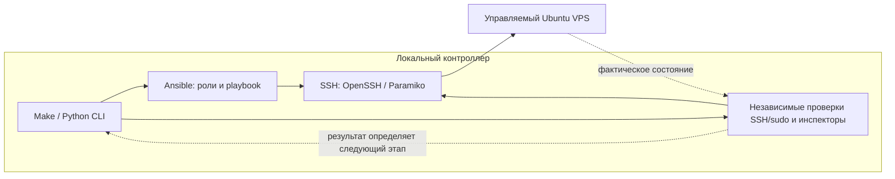

# Portfolio Server Infrastructure

[English](README.md) | **Русский**

[](https://www.python.org/)
[](https://docs.ansible.com/ansible-core/2.18/)
[](https://docs.docker.com/engine/)
[](https://ubuntu.com/server)
[](https://github.com/DanilFaritovich/portfolio-server-infrastructure/actions/workflows/ci.yml)
[](LICENSE)

Portfolio Server Infrastructure подготавливает VPS на Ubuntu для личного портфолио или других самостоятельно размещаемых приложений. Интерактивный CLI запускает этапы Ansible, проверяет доступ между изменениями и настраивает сервер с Docker, межсетевым экраном, отдельным доступом администратора и ограниченной политикой системного обслуживания.

Проект предназначен для операторов, которые готовы оценивать права SSH и sudo и восстанавливать сервер через консоль провайдера. Развёртывание приложений выполняется отдельно: репозиторий не устанавливает сайт, обратный прокси, домены, сертификаты TLS или сети приложений.

## Возможности

- **Пошаговая инициализация:** `make init-server` объединяет первоначальную настройку доступа, Docker, защиту хоста, создание администратора, финальную защиту SSH и системное обслуживание с независимыми проверками между этапами.
- **Настройка через Ansible:** проверяемые роли и идемпотентная конфигурация; повторный запуск на настроенном сервере избегает лишних изменений и перезапусков служб.
- **Docker:** официальные пакеты Docker Engine, Compose и Buildx, ограниченные журналы контейнеров с драйвером `local` и проверка запуска временного контейнера.
- **SSH и UFW:** проверка портов SSH, правила межсетевого экрана для IPv4/IPv6 и финальный доступ только по ключам с отключением root, паролей и keyboard-interactive. Сохраняется штатный режим активации SSH через службу или сокет.
- **Управление пользователями:** отдельные человеческие ключи, явные политики sudo, просмотр учётных записей и ключей, добавление ключей, точный отзыв и защищённое удаление пользователей.
- **Системное обслуживание:** автоматические обновления из Ubuntu security, ограничение журналов journald и штатные таймеры обслуживания, без автоматической перезагрузки и удаления пакетов.
- **Обработка ошибок:** строгое доверие к ключу хоста, подтверждения с отказом по умолчанию, проверка неизменности состояния, блокировки и маркеры незавершённой активации. Ошибка останавливает следующие этапы; сохранённый доступ администратора и консоль позволяют восстановить сервер осознанно.

## Технологический стек

| Технология | Назначение в проекте |
| --- | --- |
| Python 3.12 | Управляемый проектом runtime контроллера для CLI, проверок и локальной VM; сервер использует собственный `/usr/bin/python3` |
| Ansible Core 2.18.6 · `ansible.posix` 2.0.0 | Отдельные роли настройки и playbook проверки каждого этапа сервера |
| OpenSSH · Paramiko 5.0.0 | Управляемый доступ только по ключам и независимые проверки; закреплённый транспорт первоначального входа по паролю и подписанные проверки доверия к хосту |
| Docker Engine · Compose · Buildx | Официальные серверные пакеты, ограниченные журналы контейнеров и проверка запуска; версии поступают из APT-репозитория Docker |
| Ubuntu · systemd · UFW | Целевая ОС, активация SSH через службу/сокет, межсетевой экран, journald и таймеры обновлений безопасности |
| uv 0.12.23 · Make | Установка локальных инструментов с проверкой контрольных сумм и единый интерфейс команд |
| ansible-lint 25.5.0 · yamllint 1.38.0 · actionlint 1.7.7 · unittest | Offline-проверки конфигурации, workflow и регрессионные тесты контроллера |
| KVM/QEMU · libvirt · cloud-init | Необязательная изолированная локальная Ubuntu VM для интеграционных прогонов оператором |

Версии инструментов контроллера закреплены в [requirements-dev.txt](requirements-dev.txt), [collections.yml](collections.yml) и [скриптах установки](scripts/setup.sh). Ограничения серверных релизов и результаты проверки платформ приведены в разделе [совместимости](#совместимость); CI работает на Ubuntu 24.04.

## Архитектура

Контроллер — ваш локальный компьютер, управляемый хост — сервер Ubuntu. CLI отвечает за локальные ключи, доверие, подтверждения и порядок действий. Роли Ansible применяют конфигурацию; независимые подключения SSH и серверные инспекторы проверяют результат.



**Порядок инициализации:** локальная подготовка → доступ автоматизации → Docker → порты SSH/UFW → человеческий администратор → финальная политика SSH → подтверждённое системное обслуживание → СТОП. Независимая проверка каждого этапа должна пройти до следующего; приложения развёртываются отдельно.

| Граница | Ответственность |
| --- | --- |
| Локальный контроллер: `scripts/access.py` → `portfolio_cli` | Проверка входных данных, выбор ключей, доверие к хосту, подтверждение планов и последовательный запуск этапов |
| Управляемый VPS: `playbooks/` и `roles/` | Применение выбранного этапа через Ansible; серверные `library/` и `scripts/user_management.py` остаются отдельными компонентами |
| Независимая проверка: SSH и потоковые инспекторы | Доказательство доступа и фактического состояния сервера; инспекторы без изменений передаются через stdin без файлов на сервере |
| Необязательная локальная VM: `scripts/e2e.py` → существующий CLI | Управление изолированными гостем/NAT/снимками и защита запуска сценария; повторное использование этапов настройки и проверки |

Ответственность модулей и границы безопасности описаны в [ARCHITECTURE.md](ARCHITECTURE.md), процедуры отдельных этапов — в [руководстве оператора](docs/operator-guide.ru.md).

## Ключевые инженерные решения

| Решение | Причина и следствие |
| --- | --- |
| Отделить изменения от независимой проверки | Успешный recap Ansible сам по себе не доказывает возможность будущего входа. Свежие проверки SSH по ключу/sudo и состояния этапа определяют возможность следующих операций |
| Явно управлять переходами аутентификации | Первоначальный вход по паролю, автоматизация и человеческое администрирование используют отдельные пути доступа. Финальные ограничения SSH требуют доказанного независимого доступа администратора и подтверждения восстановления |
| Проверять конфигурацию до активации | Полный кандидат SSH и фактические слушатели проверяются до активации. Маркеры Docker, SSH Stage 3 и journald сохраняют свидетельство незавершённой активации |
| Блокировать опасный дрейф вместо автоматического исправления | Предварительные проверки отклоняют неуправляемое или неоднозначное состояние; реестры принадлежности, снимки и блокировки ограничивают согласованные изменения. Перед явным продолжением оператор диагностирует ошибку |
| Устанавливать инструменты локально | Закреплённые зависимости и установщики с проверкой контрольных сумм исключают необходимость системных Python/uv и обеспечивают общий набор инструментов для Make и дочерних процессов Ansible |
| Повторно использовать рабочий процесс в изолированном E2E | Сценарии VM вызывают существующие команды инициализации/перезагрузки с обычными подтверждениями. Offline-тесты имитируют внешние команды; реальные VM и production проверяет оператор отдельно |

## Документация и маршруты работы

Для нового VPS начните с [быстрого старта](#быстрый-старт), затем используйте [справочник команд](#справочник-команд) для отдельных операций. Перед LIVE-изменениями изучите [безопасность и восстановление](#безопасность-ограничения-и-восстановление).

- [Руководство оператора](docs/operator-guide.ru.md): подробные контракты этапов, миграция inventory, перенос ключей/доверия и восстановление.
- [Архитектура](ARCHITECTURE.md): ответственность модулей, зависимости и границы безопасности.
- [Руководство локального VM E2E](docs/local-vm-e2e.ru.md): подготовка хоста, проверки через консоль, снимки и жизненный цикл стенда.
- [Отчёт о проверках](docs/validation.ru.md): результаты offline-проверок и прогонов оператора с границами подтверждений.

## Системные требования

| Компонент | Требования |
| --- | --- |
| Контроллер | Linux x86_64 или arm64 с glibc; Git, Make, POSIX shell, curl, tar/gzip, coreutils с `sha256sum` и клиенты OpenSSH (`ssh`, `ssh-keygen`, `ssh-keyscan`, `scp`, `sftp`) |
| Локальные инструменты | Setup загружает закреплённые версии uv, управляемый Python 3.12, Ansible, Paramiko, коллекции и инструменты проверки внутрь проекта. Предустановленные Python/uv, Go и sshpass не нужны |
| Управляемый хост | Ubuntu Server с systemd, `/usr/bin/python3`, `python3-apt`, `/bin/bash`, sudo, `/usr/sbin/visudo` и активным включением `/etc/sudoers.d`. Роль Docker допускает Jammy 22.04, Noble 24.04 и Resolute 26.04; это не означает подтверждённый E2E-прогон каждой версии |
| Первоначальный доступ | Новый хост с доступом root по паролю SSH либо существующий администратор с паролем и sudo. Подтверждённый fingerprint ключа хоста от провайдера, проверенная консоль восстановления и сохранённая административная сессия |
| Сеть | Контроллеру нужен доступ к реестрам зависимостей; серверу — к репозиториям Ubuntu/Docker и Docker Hub. Межсетевой экран провайдера должен пропускать нужные порты SSH |
| Необязательный локальный E2E | Linux x86_64, аппаратная виртуализация, KVM и системный libvirt, минимум 2 доступных ядра, 4 ГиБ памяти для гостя и место для диска 25 ГиБ, образа и снимков |

Запускайте Make от обычного пользователя контроллера. `make setup` не использует sudo и не устанавливает системные пакеты. Подготовка E2E может предложить отдельно подтверждаемые изменения пакетов, групп и хранилища; сначала изучите [требования к хосту](docs/local-vm-e2e.ru.md#подготовка-хоста-явное-согласие-оператора).

## Быстрый старт

Этот маршрут предназначен для **нового сервера**. Команды после локальной подготовки обращаются к серверу и могут менять его (**LIVE**). До подтверждения плана проверьте адрес и права, разрешите SSH в межсетевом экране провайдера и проверьте восстановление через его консоль. Для уже защищённого сервера используйте [процедуру миграции](docs/operator-guide.ru.md#настройка-рабочего-пользователя-и-миграция), а не первоначальную настройку по паролю.

### 1. Клонируйте проект и подготовьте контроллер

```bash
git clone https://github.com/DanilFaritovich/portfolio-server-infrastructure.git
cd portfolio-server-infrastructure
make setup
```

Изучите и подтвердите локальный план установки зависимостей. Setup создаёт `inventories/production.yml` из [примера](inventories/production.example.yml), только если файл отсутствует, и никогда не перезаписывает существующий inventory. Инструменты остаются в `.tools/`, `.venv`, `.ansible/` и `.cache/`. Setup требует доступа к реестрам, но не обращается к VPS.

### 2. Настройте inventory

Отредактируйте локальный `inventories/production.yml`, сохранив структуру с одним хостом. Замените `vps.example.invalid` точным именем или IP сервера и укажите существующий порт SSH:

```yaml
all:
  children:
    bootstrap:
      hosts:
        portfolio:
          ansible_host: vps.example.invalid
          ansible_port: 22
          bootstrap_login_user: root
          ansible_user: ansible
          ansible_private_key_file: ~/.ssh/portfolio-server-infrastructure/ansible_ed25519
          ansible_python_interpreter: /usr/bin/python3
          swap_size_mb: 2048
          ssh_listen_ports: [22]
          ssh_verify_ports: [22]
          firewall_allowed_tcp_ports: [80, 443]
```

Задавайте три поля доступа вместе: `bootstrap_login_user` используется только для первоначального подключения по паролю, а `ansible_user` и `ansible_private_key_file` определяют последующий управляемый доступ. Выберите свободное имя пользователя автоматизации, отличное от root. Не помещайте в inventory пароли, содержимое ключей и посторонние переменные; реальные inventory не должны попадать в Git.

При смене портов сохраняйте текущий порт SSH в `ssh_listen_ports`. По умолчанию `ssh_verify_ports` проверяет все слушающие порты и должен включать текущий порт inventory. Открытие 80/443 не устанавливает веб-сервер. См. [смену портов и требования к сети провайдера](docs/operator-guide.ru.md#host-hardening-stage-3).

### 3. Подготовьте независимый ключ администратора

Выберите свободное имя учётной записи, например `portfolio_admin`:

```bash
make generate-user-key HUMAN_USER=portfolio_admin
make show-public-key HUMAN_USER=portfolio_admin
```

Ключ по умолчанию: `~/.ssh/portfolio-infra/portfolio_admin_ed25519`; существующие пары сохраняются. Для зашифрованного ключа загрузите его через `make load-user-key HUMAN_USER=portfolio_admin` в существующий SSH agent текущей оболочки. CLI не запускает agent; подробности — в [руководстве по ключам](docs/operator-guide.ru.md#загрузка-в-agent-и-новый-компьютер-с-одним-зашифрованным-ключом). Ключ автоматизации создаётся отдельно при bootstrap, без парольной фразы. Автоматизация и `HUMAN_SUDO=admin` дают root-эквивалентный `NOPASSWD: ALL`; защищайте контроллер и ключи.

### 4. Инициализируйте сервер

В интерактивном терминале:

```bash
make init-server INIT_FROM=bootstrap HUMAN_USER=portfolio_admin HUMAN_SUDO=admin \
  HUMAN_KEY="$HOME/.ssh/portfolio-infra/portfolio_admin_ed25519" \
  HUMAN_PUBLIC_KEY="$HOME/.ssh/portfolio-infra/portfolio_admin_ed25519.pub"
```

Изучите предварительный план и подтвердите доступность восстановления. Подтверждение с отказом по умолчанию распространяется только на перечисленные действия текущего запуска; штатные запросы доверия к хосту, пароля и парольной фразы сохраняются. При первом подключении сравните показанный fingerprint с консолью или панелью провайдера до принятия доверия. Сетевой опрос сам по себе не подтверждает личность сервера. Пароль bootstrap вводится в штатном запросе Ansible и не сохраняется проектом.

Инициализация проверяет каждый этап до перехода к следующему. Финальная защита SSH требует независимого доказательства доступа администратора и автоматизации. Только после этих проверок отключаются root, пароль и keyboard-interactive в SSH; Stage 5 настраивает плановые обновления безопасности и ограничения журналов. Развёртывание приложений и перезагрузка не выполняются.

### 5. Проверьте готовый сервер

```bash
make init-server INIT_FROM=verify HUMAN_USER=portfolio_admin HUMAN_SUDO=admin \
  HUMAN_KEY="$HOME/.ssh/portfolio-infra/portfolio_admin_ed25519" \
  HUMAN_PUBLIC_KEY="$HOME/.ssh/portfolio-infra/portfolio_admin_ed25519.pub"
```

Команда проверяет все этапы без применения конфигурации. Проверка Docker создаёт и удаляет временный контейнер и может заполнить кеш образов. После проверки `make connect-user HUMAN_USER=portfolio_admin` открывает интерактивную сессию администратора.

При ошибке **остановитесь и проведите диагностику до продолжения**. `INIT_FROM` также принимает `swap`, `docker`, `hardening`, `human`, `ssh` и `operations`; предыдущие этапы должны пройти свежую проверку. Выбор более позднего этапа — явное решение после диагностики, а не автоматическое восстановление. См. [прерывания этапов](docs/operator-guide.ru.md#прерывания-этапов-и-безопасный-повтор).

### SWAP между Bootstrap и Docker

Единственный параметр inventory — `swap_size_mb: 2048` для 2 ГиБ; в существующий inventory нужно добавить явное целое значение до `init-server`. Инициализация применяет и независимо проверяет SWAP после Bootstrap и перед Docker. `INIT_FROM=swap` проверяет Bootstrap, затем применяет SWAP и последующие этапы. Успешный postflight wrapper используется в этой же операции без повторения, сохраняя оптимизацию PR #13.

`make setup-swap` требует управляемого SSH по ключу, sudo и подтверждения плана с отказом по умолчанию; `make verify-swap` выполняет независимую проверку без изменения конфигурации. Положительное значение создаёт и активирует `/swapfile` с root:root 0600 и точной управляемой записью `/etc/fstab`. Ноль отключает SWAP и убирает запись, сохраняя файл; отсутствующий файл не создаётся. Другие swap-файлы и разделы не изменяются.

Чужой `/swapfile`, небезопасные права, конфликты fstab/systemd, неподдерживаемая файловая система или изменение записи владения блокируют применение. Создание/изменение размера поддерживает ext4/XFS и требует места для полного нового файла плюс резерв 256 МиБ; отключение активного SWAP требует `MemAvailable` не меньше занятого SWAP плюс 256 МиБ. Проверки повторяются перед swapoff, а ошибка команды останавливает замену активного файла. Повтор совпадающего состояния не вносит изменений. Частичный сбой сохраняет `/var/lib/portfolio-swap/pending`, запись владения и, возможно, подготовленный файл в корне: STOP, диагностика через recovery, без слепых повторов или автоматического удаления свидетельств. См. [руководство оператора](docs/operator-guide.ru.md#управление-swap).

## Справочник команд

Здесь перечислены реальные цели [Makefile](Makefile). По умолчанию серверные команды используют `INVENTORY=inventories/production.yml`. Локальные действия, offline-проверки и LIVE-операции с сервером или VM имеют разные последствия; проверка не всегда обходится без изменений во время выполнения.

### Контроллер и offline-проверки

| Команда | Назначение и последствия |
| --- | --- |
| `make setup` | Установка локальных инструментов и создание отсутствующего inventory; нужен доступ к реестрам |
| `make deps` / `make deps-ci` | Только зависимости: интерактивно / явно разрешённый режим CI без терминала |
| `make generate-user-key HUMAN_USER=NAME` / `make load-user-key HUMAN_USER=NAME` | Создание ключа без перезаписи / загрузка в существующий agent |
| `make show-public-key HUMAN_USER=NAME` / `make copy-public-key HUMAN_USER=NAME` | Просмотр / копирование только публичного ключа |
| `make show-controller` | Локальная проверка ключа/доверия и просмотр доступа из inventory |
| `make check` / `make ci` | Все offline-проверки с примером inventory и синтетическими данными |

Подробности [ключей и интерактивного SSH](docs/operator-guide.ru.md#локальные-ключи-и-интерактивный-ssh), [экспорта/импорта доверия](docs/operator-guide.ru.md#перенос-доверия-к-серверу-на-второй-компьютер) и [отдельных проверок](docs/operator-guide.ru.md#команды-и-границы) — в руководстве оператора. Импорт доверия требует подтверждения; необязательная LIVE-проверка другого порта подтверждается отдельно. Копирование в буфер может предложить установку локальных пакетов.

### Инициализация и обслуживание сервера — LIVE

| Команда | Назначение и последствия |
| --- | --- |
| `make init-server` | Пошаговая инициализация или полная проверка; этап задаётся через `INIT_FROM` |
| `make bootstrap-user` / `make verify-access` | Создание доступа автоматизации / независимая проверка SSH по ключу и sudo |
| `make setup-swap` / `make verify-swap` | Подтверждённое управление своим `/swapfile` / независимая проверка размера, активности и сохранения состояния |
| `make docker-host` / `make verify-docker` | Установка Docker с итоговой проверкой / проверка работы и временного контейнера |
| `make inspect-hardening` | Отчёт о безопасности Stage 3 без изменений; FAIL блокирует применение |
| `make harden` / `make verify-hardening` | Настройка портов SSH и UFW / проверка слушателей, маршрутов и межсетевого экрана |
| `make add-user` / `make verify-user` | Регистрация человеческого доступа / проверка выбранного ключа и политики sudo |
| `make secure-ssh` / `make verify-ssh-security` | Применение финальной политики аутентификации / проверка политики и независимого доступа |
| `make inspect-operations` | Проверка готовности системного обслуживания без изменений |
| `make setup-operations` / `make verify-operations` | Настройка обновлений безопасности, журналов и таймеров / проверка политики и служб |
| `make preview-apt-policy` / `make apply-apt-policy` | LIVE check-diff / подтверждённая миграция одной отсутствующей строки APT; более широкий дрейф блокируется |
| `make reboot-host` | Подтверждённая перезагрузка; затем проверка доступа, Docker и защиты Stage 3 |
| `make connect-controller` / `make connect-user HUMAN_USER=NAME` | Интерактивный SSH по ключу от контроллера из inventory / выбранного пользователя |

### Пользователи и ключи — LIVE

| Команда | Назначение и последствия |
| --- | --- |
| `make list-users` / `make show-user HUMAN_USER=NAME` / `make list-user-keys HUMAN_USER=NAME` | Просмотр зарегистрированных пользователей, прав и ключей |
| `make add-user-key HUMAN_USER=NAME HUMAN_PUBLIC_KEY=/path/key.pub` | Добавление одного явного публичного ключа с сохранением остальных |
| `make revoke-user-key HUMAN_USER=NAME KEY_FINGERPRINT=SHA256:...` | Отзыв одного управляемого ключа; отдельная recovery-проверка |
| `make remove-user HUMAN_USER=NAME` | Отзыв доступа/sudo и удаление учётной записи с сохранением файлов; отдельная recovery-проверка |

`add-user` требует явный публичный файл либо вставку ключа в терминале. Разрушительные операции требуют `RECOVERY_USER`/`RECOVERY_KEY` другого независимо проверенного администратора с непересекающимися ключами; root, текущий контроллер и неуправляемое состояние защищены. Политики sudo/групп, добавление ключей без миграции прав и ограничения удаления описаны в [руководстве по пользователям](docs/operator-guide.ru.md#управление-пользователями-и-ssh-ключами-stage-6-задача-3).

### Локальная VM — реальные локальные операции

`make e2e-list-distros` читает только локальный реестр. `make e2e-prepare`, `make e2e-status`, `make e2e-test`, `make e2e-reset` и `make e2e-delete` управляют настоящим стендом вне CI. Краткий сценарий — [ниже](#e2e-на-реальной-ubuntu-vm); условия подготовки, остановки и удаления — в [руководстве E2E](docs/local-vm-e2e.ru.md).

## Тестирование и подтверждённые результаты

После установки зависимостей:

```bash
make check
```

Проверки включают YAML/Ansible/workflow lint, синтаксис Ansible и offline Python-тесты с синтетическими данными и имитацией SSH, загрузок и команд гипервизора. Используется пример inventory, production-доступ не требуется, подключение к серверу и запуск VM не выполняются. [GitHub Actions](.github/workflows/ci.yml) запускает `make deps-ci`, затем `make ci` на Ubuntu 24.04.

Реальный E2E на госте Ubuntu Server 24.04 LTS amd64 с контроллером Ubuntu 26.04 выполнен вручную оператором: [PR #11](https://github.com/DanilFaritovich/portfolio-server-infrastructure/pull/11) подтверждает подготовку/инициализацию, а последующее подтверждение оператора — повторный прогон, перезагрузку, управление пользователями и удаление. Это ранее записанные результаты, не новые запуски при редактировании документации; подробные источники и ограничения — в [отчёте о проверках](docs/validation.ru.md).

Оператор также сообщает об успешной проверке полного E2E на отдельной Ubuntu VM с nested virtualization. Новые независимые команды ниже в этом изменении проверены только offline; реальные E2E и подключения к VPS не выполнялись.

| Проверка | Записанный результат |
| --- | --- |
| Offline / CI: линтеры, синтаксис Ansible, Python-тесты | Успешно |
| E2E: создание VM и полная инициализация Stage 1–5 | Успешно |
| E2E: финальная проверка, повторная сходимость и проверка после перезагрузки | Успешно; изменения временного Docker-теста остаются ожидаемыми |
| E2E: создание/проверка пользователя, добавление/отзыв ключей, удаление пользователя и стенда | Успешно |
| Внешний production VPS, другие платформы | Этим прогоном не подтверждены |

Offline-успех не доказывает реальный доступ, идемпотентность или восстановление через провайдера; результат VM не подтверждает все разрешённые релизы и платформы.

## E2E на реальной Ubuntu VM

Этот необязательный интерактивный маршрут создаёт настоящего локального гостя KVM/libvirt с изолированными inventory, HOME, ключами и доверием к хосту. Он не входит в offline-проверки и CI. Прочитайте [подробное руководство E2E](docs/local-vm-e2e.ru.md) до подтверждения изменений хоста и создания VM. Реестр содержит Ubuntu Server 24.04 LTS (по умолчанию) и 22.04 LTS.

### Подготовьте стенд и запустите полный сценарий

```bash
make deps
make e2e-list-distros
make e2e-prepare E2E_DISTRO=ubuntu-24.04
make e2e-status
make e2e-test E2E_FROM=bootstrap
```

Переходите к следующей команде только после успеха предыдущей. До создания VM изучите [первый запуск и проверки через консоль](docs/local-vm-e2e.ru.md#подготовка-и-первый-запуск): изменения пакетов/групп/хранилища требуют согласия, а fingerprint и recovery-доступ — проверки. Готовность ограничена 300 секундами, корректное выключение — 120; ошибки сохраняют стенд для диагностики без автоматического сброса.

Сценарий создаёт отдельного `e2e_admin`, инициализирует и проверяет сервер, требует сходимости настройки с `changed=0` и проверяет состояние после перезагрузки. Подробности [сценария](docs/local-vm-e2e.ru.md#изоляция-и-выполнение-сценария) и [reset/удаления/восстановления](docs/local-vm-e2e.ru.md#сброс-удаление-и-незавершённая-подготовка) остаются в руководстве.

### Запустите независимые проверки на настроенной VM

После успешной полной инициализации принадлежащий стенду гость должен уже работать, с доступом `ansible` и `e2e_admin` по ключам, sudo и существующим доверием к хосту. В терминале выполните любую из двух независимых команд:

```bash
make e2e-test-users
make e2e-test-swap
```

`e2e-test-users` проверяет отдельные временные учётные записи с sudo `admin`, `none` и `restricted`: точный список управляемых пользователей, группы, владение ключами, безопасные разрешённые/запрещённые sudo-операции, отказ SSH до регистрации ключа и после отзыва/удаления, повторы операций без изменения состояния. После удаления `getent`, `list-users` и хеши home-файлов независимо подтверждают отсутствие пользователя и сохранение файлов. После всех операций повторно проверяется доступ `ansible`/`e2e_admin`; новые ключи остаются в HOME стенда, штатные запросы сохраняются.

`e2e-test-swap` вызывает существующие `setup-swap`/`verify-swap` для 512 → 1024 → 0 → 512 МиБ, проверяет `changed=0` в каждом состоянии и после обеих существующих перезагрузок, сохранение файла 1024 МиБ при отключении и сохранение состояния после двух перезагрузок (отключено и повторно включено). Итоговый желаемый размер — 512 МиБ; основной inventory стенда не меняется.

Обе команды работают без Bootstrap и `init-server`, сохраняют штатные проверки безопасности, подтверждения и независимый recovery-доступ, держат блокировку стенда и останавливаются при ошибках без reset или автоматической очистки. Подробности — в [руководстве независимых сценариев](docs/local-vm-e2e.ru.md#независимые-тесты-на-настроенной-vm).

В работающем госте выполните сценарий создания пользователя, проверки обоих ключей, отзыва дополнительного ключа и удаления учётной записи из [руководства оператора](docs/operator-guide.ru.md#проверьте-пользователей-и-ключи). Сохраните доступ к консоли и отдельного recovery-администратора. Обёртки не запускают и не сбрасывают VM; удаление стенда требует отдельного подтверждения.

## Совместимость

| Платформа | Статус и ограничения |
| --- | --- |
| Linux-контроллер, glibc x86_64/arm64 | Реализована локальная установка инструментов; подтверждённый прогон ограничен окружением из таблицы результатов |
| Ubuntu Server | Docker допускает 22.04/24.04/26.04 при прохождении всех предварительных проверок; разрешённые релизы не означают E2E-подтверждение |
| Windows через WSL2 | **Не проверялось.** Нужны Linux-зависимости; agent, пути, буфер обмена и сеть требуют независимых проверок. Подтверждённого E2E с KVM/libvirt нет |
| Нативные Windows / macOS как контроллер | Полная установка не поддерживается установщиком инструментов, рассчитанным только на Linux. Наличие macOS-бэкенда буфера обмена не означает поддержку всей платформы |
| Другие серверные ОС / нестандартная конфигурация хоста | За пределами реализованного Ubuntu-конвейера; нестандартные политики SSH/systemd/UFW/Docker могут блокироваться предварительной проверкой безопасности |

Пригодность E2E-хоста определяется возможностями Linux x86_64/KVM/libvirt, а не списком версий ОС хоста. Автоматическая установка недостающих пакетов ограничена проверенными окружениями Ubuntu/Debian с APT; на других системах зависимости устанавливаются вручную. Запись в реестре или разрешающий список в коде не доказывают успешный сквозной прогон.

### Windows через WSL2 — не проверено

Это предварительный маршрут запуска Linux CLI, а не официально протестированная платформа. Нужны Windows с поддержкой WSL2, включённая аппаратная виртуализация и Linux-дистрибутив Ubuntu с glibc на x86_64/arm64.

1. Установите WSL/Ubuntu через `wsl --install` из PowerShell администратора и перезагрузите Windows по [инструкции Microsoft](https://learn.microsoft.com/en-us/windows/wsl/install). Проверьте версию 2 командой `wsl --list --verbose`.
2. Откройте Ubuntu, создайте обычного Linux-пользователя и установите Git, Make, curl, tar/gzip, coreutils и OpenSSH client. Держите репозиторий и ключи в Linux HOME, например `~/work/`, чтобы сохранять Linux-права доступа.
3. Выполните команды клонирования и `make setup` из [быстрого старта](#быстрый-старт) внутри WSL. Системные Python/uv не требуются. До LIVE-команд проверьте доступ к реестрам и SSH-порту VPS, host trust и загрузку зашифрованного ключа в agent этой Linux-оболочки.

Пути, agent, сеть и буфер обмена требуют самостоятельной проверки. Локальный E2E через KVM/libvirt в WSL2 **не подтверждён**; успешная установка WSL не доказывает пригодность VM-стенда.

## Безопасность, ограничения и восстановление

Не помещайте inventory, приватные ключи, пароли и диагностические журналы в Git. Передаются только публичные ключи; приватные данные остаются у владельца. SSH использует выбранную личность, строгое существующее доверие к хосту и отключает forwarding и влияние пользовательской конфигурации клиента. Зашифрованные ключи должны быть загружены в agent текущей оболочки. Перенос доверия подтверждается отдельно и не заменяет конфликтующие ключи хоста.

Учётная запись автоматизации и человеческие администраторы имеют sudo, эквивалентный root. Регистрация публичного ключа не доказывает доступ: независимо проверьте соответствующую личность до финальной политики SSH или разрушительных изменений. Явно оцените права дополнительных групп. На всём протяжении изменений безопасности сохраняйте проверенную консоль провайдера и административную сессию.

Идемпотентность относится к поддерживаемому неизменному управляемому состоянию. Опасный дрейф, неуправляемые учётные записи/конфигурация, конфликтующие пакеты, неоднозначное состояние UFW/SSH и незавершённая активация блокируют изменения. Проект не удаляет конфликтующие пакеты автоматически, не сбрасывает UFW, не присваивает существующие аккаунты, не очищает служебные записи, не ослабляет SSH, не откатывает прерванный конвейер и не очищает данные. Потеря SSH не доказывает завершение удалённой работы; проведите диагностику до повтора. Локальная блокировка CLI сериализует действия одного пользователя контроллера; разные компьютеры и прямые запуски Ansible нужно согласовывать вручную.

Политика входящего трафика UFW сама по себе не защищает опубликованные порты контейнеров Docker. Перед отдельным развёртыванием приложения проверьте сеть провайдера и контейнеров. Обновления безопасности могут позднее перезапускать службы через сценарии пакетов; Stage 5 не перезагружает сервер автоматически. Ограничения журналов Docker/journald не ограничивают все файлы приложений.

Перед работой с сервером используйте подробные инструкции:

- [Условия этапов, политики безопасности и диагностика](docs/operator-guide.ru.md).
- [Прерванная активация, pending-маркеры и восстановление](docs/operator-guide.ru.md#прерывания-этапов-и-безопасный-повтор).
- [Перенос доверия SSH и второй контроллер](docs/operator-guide.ru.md#перенос-доверия-к-серверу-на-второй-компьютер).
- [Миграция управляемого inventory](docs/operator-guide.ru.md#настройка-рабочего-пользователя-и-миграция).
- [Ручная интеграционная LIVE-проверка](docs/operator-guide.ru.md#stage-6-checklist-ручной-интеграционной-live-проверки).
- [Консоль локальной VM, снимки и восстановление](docs/local-vm-e2e.ru.md).

## Структура проекта

| Путь | Назначение |
| --- | --- |
| `scripts/access.py`, `scripts/portfolio_cli/` | Совместимая точка входа CLI и реализация контроллера |
| `scripts/e2e.py` | Точка входа жизненного цикла изолированной локальной VM |
| `scripts/setup.sh` | Установка локальных зависимостей и инструментов |
| `scripts/user_management.py`, `library/` | Серверное управление пользователями, инспекторы и модули |
| `playbooks/`, `roles/` | Применение и проверка этапов через Ansible |
| `plugins/connection/` | Закреплённый транспорт первоначального доступа только по паролю |
| `inventories/production.example.yml` | Пример inventory в Git; реальные inventory остаются локальными |
| `tests/`, `.github/workflows/ci.yml` | Offline-регрессии и CI |
| `docs/`, `ARCHITECTURE.md` | Процедуры оператора, результаты проверок и архитектура |

## Лицензия

[MIT License](LICENSE), © 2026 Danil Miftakhov.
